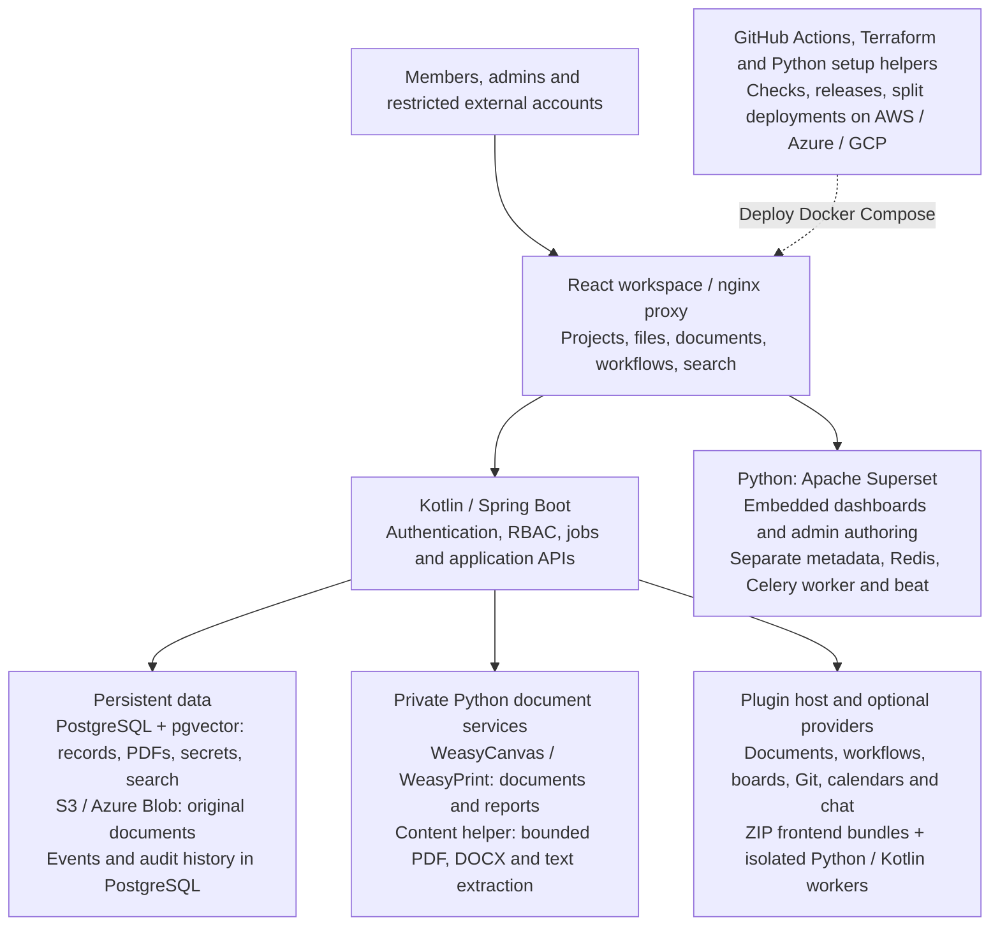

# Meshable Ops

**Connect your people, projects, documents, and operations. On your infrastructure.**

[](.github/workflows/pipeline.yml)
[](LICENSE)
[](docs/deployment.md)

Meshable Ops is an extensible business workspace for teams that want control over their tools and data. Manage clients and projects, connect cloud files, create documents, follow workflows, and bring analytics and communication together. Enable the plugins your business needs and make the workspace your own.

[Get started](#quick-start) · [Documentation](docs/README.md) · [Create a plugin](docs/plugins/README.md) · [Contribute](CONTRIBUTING.md)

## Connected capabilities

| Capability | Included |
| --- | --- |
| **Clients and delivery** | Project portfolios, team boundaries, Jira-style boards, column permissions, epics, tagged tickets, sprints, Git/PR links, project charts, reports and work digests. [Projects](docs/projects-and-delivery.md) · [Boards](docs/plugins/kanban.md) |
| **Files and documents** | Named S3/Azure Blob locations, file permissions, PDF previews, download policies, protected sharing, and an optional document-generator plugin with WeasyCanvas templates and calculated fields. [Files](docs/storage-connections.md) · [Documents](docs/documents-and-workflows.md) |
| **Processes and insight** | Optional visual workflow design and guided member runs, multiple Apache Superset dashboards, and permission-aware search with optional AI. [Workflows](docs/plugins/documents-and-workflows.md) · [Search](docs/search-and-indexing.md) |
| **Connected teams** | SMTP/API email, notification templates and preferences, webhooks, personal calendar sync, and separate Git, Discord, Telegram, Teams, WhatsApp, Microsoft file and Google Drive plugins. [Plugins](docs/plugins/README.md) |
| **Time, billing and service operations** | Optional project timesheets, ActivityWatch/TimeCamp imports, developer rates, invoices/quotes, billing replies, cloud costs and on-call escalation. [Operations plugins](docs/plugins/operations.md) |
| **Your workspace** | Business branding, ordered navigation, project/section icons, optional MFA, delegated administration, restricted external file access, encrypted secrets, and sandboxed ZIP extensions. [Access](docs/access-controls.md) · [Branding](docs/branding.md) · [Navigation](docs/navigation-and-icons.md) |

## Quick start

Install **Python 3**, **Docker Engine**, and **Docker Compose**. From a fresh clone:

```bash
git clone https://github.com/GrahamCHill/Contract-Management-Template.git
cd Contract-Management-Template
python deploy/github/setup-instance.py --local --admin-email owner@example.com
docker compose -f docker-compose.yml -f docker-compose.dev.yml up --build -d --remove-orphans
```

Open [localhost:3000](http://localhost:3000) and sign in with the credentials you chose during setup. Business data starts empty; plugins, outbound email, and project schedules need configuration. The local profile supplies MinIO. See [development setup](docs/getting-started.md) for PowerShell/Azurite and [deployment](docs/github-deployment.md) for opt-in GitHub Actions deployment to a Linux VM over SSH.

## Deployment options

| Destination | Provisioning |
| --- | --- |
| **Existing Linux VM** | [Manual walkthrough](docs/linux-vm-deployment.md) or [GitHub Actions over SSH](docs/github-deployment.md), with Caddy HTTPS and production Compose. |
| **AWS with Terraform** | [Private RDS PostgreSQL, separate app/services/runtime hosts, VPC routing/NAT, and S3](docs/terraform-deployment.md#aws). |
| **Azure with Terraform** | [Private PostgreSQL Flexible Server, separate VM tiers, web load balancer, NAT, Blob, and optional Bastion](docs/terraform-deployment.md#azure). |
| **GCP with Terraform** | [Private Cloud SQL, separate VM tiers, custom VPC/Cloud NAT, static web IP, and IAP administration](docs/terraform-deployment.md#gcp). |

The cloud templates provision networking and managed PostgreSQL, separating the application from private analytics/history and Python/plugin execution. Follow the [step-by-step Terraform guide](docs/terraform-deployment.md) for cloud access, DNS, verification and upgrades, and [environment settings](docs/deployment-environment.md) for exactly where credentials belong.

## Architecture



Kotlin enforces permissions before records, files, reports, or search results are returned. Python renders documents/reports and extracts supported file content; local search works without AI or the extraction service. Superset has its own Python analytics runtime. [Architecture and data flow](docs/architecture.md) explains service boundaries and includes the detailed diagram.

## Extend and contribute

Create plugins with pages, submenus, settings, managed tables, search, and client/project extension points. [Full-stack plugins](docs/plugins/full-stack.md) support React, Kotlin and Python. A ZIP can install frontend bundles, isolated backend code, or both without rebuilding the app; backend-only plugins need no page. See the [working example](examples/plugins/full-stack/). Documents and Workflows are separately optional plugins with normal workspace/admin pages. See [plugin authoring](docs/plugins/README.md), [contribution guidance](CONTRIBUTING.md), and [CLA](CLA.md).

Installed ZIP plugins and their saved data persist across application updates. Authors can declare supported app releases or ranges; missing/mismatched versions show caution and backup advice. [Compatibility and updates](docs/plugins/compatibility-and-updates.md).

The project is evolving. Providers require your credentials and permissions; external invitations are deferred, and OCR engines connect through an external adapter. [Feature guides](docs/README.md) describe behavior and limits.

## License

**Source available under the Meshable Ops Community License, with strong same-license source sharing and an upstream grant-back.** Community modifications and forks are allowed if covered source is supplied to recipients/network users and fork changes grant this project royalty-free reuse, merging and sublicensing rights, including commercial releases, with source on request. Hosting on AWS/GCP/Azure or other providers, paid setup/management/maintenance, necessary installer/deployment changes, built-in customization and paid source-sharing plugins remain allowed. Application paywalls, closed-source offerings and branding beyond exposed customization require express written exceptions from the creator or an authorized Licensing Maintainer. Apache Superset and dependencies retain their own terms. Read [LICENSE](LICENSE), [licensing examples](LICENSING.md), [authority](MAINTAINERS.md), and [third-party notices](THIRD_PARTY_NOTICES.md).

Covered plugins inherit the app's community license. Independently authored service-integration components may retain compatible licenses, and independent external services keep their own terms. See [plugin licensing](docs/plugins/licensing.md).
