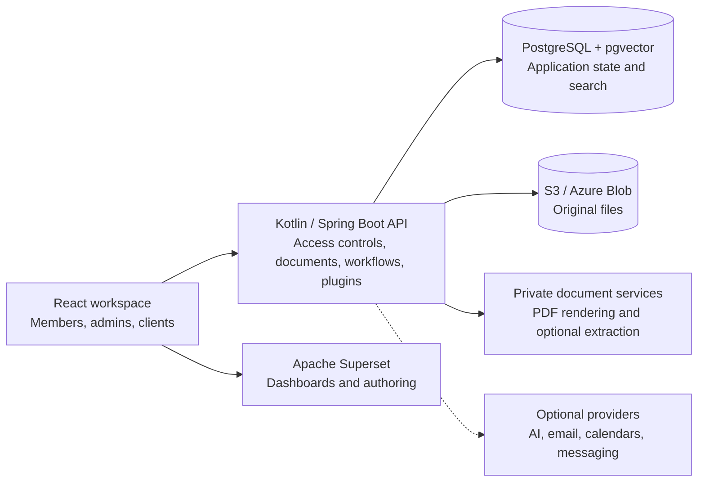
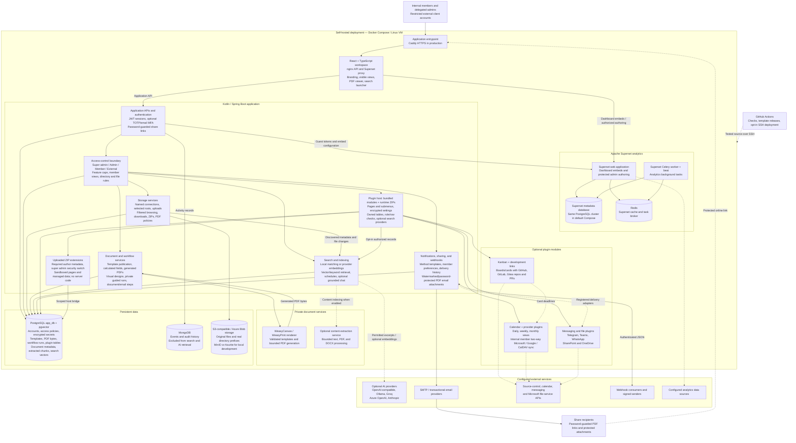

# WeaveOps

### Bring your documents, workflows, and business data together.

[](.github/workflows/pipeline.yml)
[](LICENSE)
[](docs/deployment.md)

**WeaveOps is an extensible, self-hosted business operations workspace.** Give your team one place to work with client files, create documents, follow processes, find information, and explore dashboards—with access controls that follow the data.

Built for growing businesses and teams building their own internal platforms. Start with the core workspace, enable the plugins you need, and make it your own with your business name, branding, and integrations.

[Get started](#quick-start) · [Explore the architecture](#architecture) · [Read the docs](docs/README.md) · [Build a plugin](docs/plugins/README.md) · [Licensing](#licensing)

## One workspace, connected capabilities

| Capability | What your team can do |
| --- | --- |
| **Files and client access** | Connect named S3-compatible buckets or Azure Blob containers. Grant specific directories or files, exclude protected material, and preview PDFs. [Access controls](docs/access-controls.md) |
| **Documents and processes** | Design reusable WeasyCanvas templates with typed and calculated fields. Generate PDFs and guide members through published workflows with saved progress, conditions, reviews, and email steps. [Guide](docs/documents-and-workflows.md) |
| **Search and optional AI** | Search permitted storage by meaning or keywords, schedule reindexing, and add document chat with configurable providers. Local search works without an AI service. [Search](docs/search-and-indexing.md) |
| **Business insights** | Bring multiple Apache Superset dashboards into the workspace, with clear navigation, role visibility, and an admin authoring area. [Dashboards](docs/dashboards.md) |
| **Communication** | Configure SMTP or transactional email, per-method notification templates and member preferences, protected PDF attachments, and incoming/outgoing webhooks. [Notifications](docs/notifications.md) |
| **Plugins that work together** | Enable boards, repository links, calendars, private member sync, messaging, and Microsoft file integrations. Install runtime ZIP extensions with pages, submenus, settings, managed data, and search. [Plugin ecosystem](docs/plugins/README.md) |
| **Workspace control** | Delegate administration, restrict member views, enable optional authenticator/email MFA, and customize branding. Saved provider secrets are encrypted; account passwords use salted bcrypt. [Administration](docs/administration.md) |

## Quick start

Install **Python 3**, **Docker Engine**, and **Docker Compose**. From a fresh clone, create private settings and choose your initial super-admin password:

```bash
git clone https://github.com/GrahamCHill/Contract-Management-Template.git
cd Contract-Management-Template
python deploy/github/setup-instance.py --local --admin-email owner@example.com
docker compose -f docker-compose.yml -f docker-compose.dev.yml up --build -d --remove-orphans
```

Open [localhost:3000](http://localhost:3000) and sign in with your chosen email and password. The local profile supplies MinIO storage; business records and dashboards start empty. External members have no file access until granted, and optional plugins start disabled.

Follow [development setup](docs/getting-started.md) for PowerShell and Azurite. For production, use the [deployment guide](docs/deployment.md) or [GitHub Actions deployment](docs/github-deployment.md): template releases, checks, and opt-in deployment to your Linux VM over SSH.

## Architecture

The browser uses one application entrypoint. The backend enforces view, role, ownership, and storage-path permissions; original files stay in object storage, and generated PDFs and application state live in PostgreSQL.



<details>
<summary><strong>Expand the complete application and integration diagram</strong></summary>



Solid lines show primary service/data paths; dotted lines show optional connections or deployment. PostgreSQL and object storage serve different purposes; MongoDB is not a search source. Redis/Celery support Superset, while application indexing and calendar jobs run in the Kotlin backend. Bundled plugins are reviewed source modules; [ZIP extensions](docs/plugins/zip-packages.md) load dynamically in sandboxed frames after super admin approval.

See [architecture](docs/architecture.md), [database layout](docs/database-layout.md), and [plugin composition](docs/plugins/composition.md) for boundaries and operational details.

</details>

## Documentation

[All guides](docs/README.md) · [Access controls and external sharing](docs/access-controls.md) · [Storage](docs/storage-connections.md) · [AI and secrets](docs/ai-search-and-secrets.md) · [API reference](docs/api.md) · [Deployment](docs/deployment.md) · [Branding](docs/branding.md)

The core is implemented and evolving. Workflows are guided member processes; external invitations and MongoDB/OCR search integration are not implemented. Provider integrations need your own configuration and credentials. Feature guides describe current behavior and limits.

## Contribute and extend

Report reproducible issues, improve the guides, or add a focused plugin. Start with [CONTRIBUTING.md](CONTRIBUTING.md), the [developer guide](docs/code-organization.md), and the [plugin authoring guides](docs/plugins/README.md). Copyrightable contributions require explicit [CLA acceptance](CLA.md) so the project can maintain both community and future commercial licensing paths.

## Licensing

**AGPL-3.0-only, with an alternative commercial licensing path.** The public license covers original WeaveOps code and the project owner's imported WeasyCanvas snapshot. Commercial use is allowed under the AGPL; a different grant requires a separate written commercial agreement. Premium commercial terms are reserved for a future offering and are not granted by this repository.

Read [LICENSE](LICENSE), the [licensing guide](LICENSING.md), and [commercial licensing notice](COMMERCIAL-LICENSE.md). Apache Superset remains Apache-2.0; other components keep their own licenses. See [third-party notices](THIRD_PARTY_NOTICES.md).
