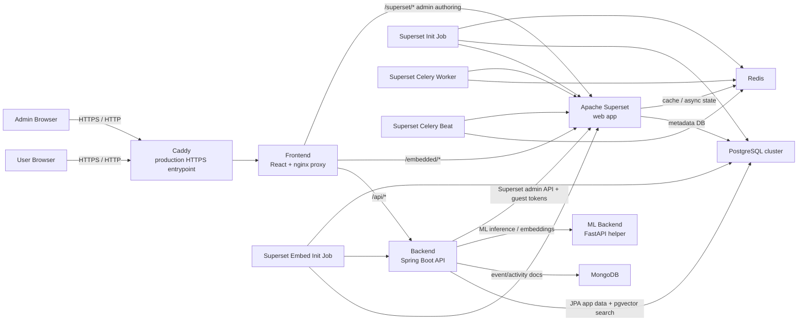

# Architecture

This document describes the current runtime architecture of the application as it exists in this repository.

## Overview

- End users access the React frontend.
- The frontend proxies backend API calls, embedded Superset dashboards, and admin-only Superset authoring routes.
- The backend owns application auth, app APIs, guest-token minting, and embed configuration management.
- Superset remains internal to the stack and is not intended to be exposed directly to users.

In practice, the architecture can be run in two main ways:

- all-in-one:
  the VM carries the frontend, backend, Superset, and the supporting data services
- app host plus offloaded state:
  the VM mainly carries the app logic and proxy layers while PostgreSQL, MongoDB, or storage live elsewhere

The current Redis service is best thought of as part of the Superset runtime side, not as a general app-runtime dependency.

The request and permission model stays the same in both cases.

## Mermaid Diagram

## Request Flow Notes

### Standard app requests

1. Browser requests hit Caddy in production.
2. Caddy forwards traffic to the `frontend` container.
3. The frontend serves the SPA and proxies `/api/*` to the backend.
4. The backend reads and writes app data in PostgreSQL (including pgvector) and MongoDB.

### Authentication and session flow

1. The browser signs in through `/api/auth/login`.
2. The backend validates credentials and issues the app auth token/session cookie.
3. The frontend uses that app session for normal API traffic.
4. Admin-only proxied Superset authoring routes are checked through the backend admin-access endpoint before the request is allowed through.

### Embedded dashboards

1. The frontend loads embedded dashboards through `/embedded/...`.
2. The backend mints Superset guest tokens.
3. The backend also syncs the active app origin into Superset embedded allowlists.
4. Superset serves the embedded dashboard without being exposed as a separate public host.

### Admin Superset authoring

1. Admins use `/admin/superset-graph-builder`.
2. The frontend proxies approved Superset authoring routes and canonicalizes several mixed Superset URL shapes into the proxied namespace.
3. The frontend proxy asks the backend whether the current user has admin access before authoring traffic is passed through.
4. Direct non-embed Superset page access is therefore enforced at the proxy layer, not just hidden in the React UI.
5. Superset still runs internally, but the admin experience is surfaced through the app shell.

## User-Facing Surfaces

The main user-visible routes are:

- `/`
  main application shell
- `/dashboards`
  embedded shared dashboards
- `/storage`
  registered storage roots and a nested S3/Azure Blob folder browser (`/items` redirects here)
- `/search`
  vector search UI
- `/events`
  event log
- `/admin`
  access management, backup/settings, audit, and admin operations
- `/admin/dashboard-links`
  admin-only Superset dashboard selection; Kotlin enables embedding and owns the embed UUID
- `/admin/superset-graph-builder`
  embedded Superset authoring workspace

## Role and Access Model

The effective permission split is:

- authenticated users:
  can sign in, view shared items, run search, and view enabled dashboard embeds allowed for their role
- admins:
  can manage users, items, dashboard embed configs, admin settings, backups, vector reindexing, audit views, and Superset authoring

Important implementation detail:

- hiding links in the frontend is not the security boundary
- the nginx proxy in the frontend container is the real boundary for non-embed Superset route exposure
- `/embedded/...` remains intentionally accessible for allowed application users

## Service Responsibilities

### Frontend

The frontend does more than serve the SPA:

- serves the React app
- proxies `/api/*` to the backend
- proxies `/embedded/*` to Superset
- proxies approved admin-authoring Superset routes
- enforces admin-only authoring access through `auth_request`
- rewrites some legacy or mixed Superset routes so the embedded admin workspace remains usable

### Backend

The backend is the application control plane:

- authentication and session handling
- admin-only access checks for the proxy
- user management
- item CRUD and shared reads
- dashboard embed configuration
- guest-token minting
- vector-search orchestration
- admin settings, audit logs, and backup export

### Superset

Superset has two roles here:

- shared end-user dashboards through the embed flow
- admin-only authoring inside `Superset Graph Builder`

It is treated as an internal dependency rather than the primary public web app.

### Storage and Runtime Services

- PostgreSQL:
  application relational data and Superset metadata databases
- MongoDB:
  events and audit-style activity documents
- pgvector:
  vector index storage inside the application PostgreSQL database
- Redis:
  Superset cache and Celery coordination
- ML helper:
  embedding/vectorization helper used by the backend
- S3-compatible or Azure Blob object storage:
  application-managed storage roots and original document objects; development profiles are provided for MinIO and Azurite

Today that means:

- the backend does not depend on Redis directly
- Redis remains coupled to the Superset web/worker/beat side of the stack
- a future app-level Redis stack would be an additional architectural concern, not the current default

Folder metadata remains relational and searchable; object storage is the durable document boundary.
The planned document-processing extension is described in
[Document Folder and Processing Extension](document-processing-extension.md). Extraction,
classification, and OCR are not implemented yet. S3-compatible and Azure Blob adapters
share the same hierarchical browsing contract.

## Deployment Boundary Notes

For production, the intended public boundary is:

- Caddy on `80/443`
- frontend behind Caddy
- backend, Superset, and stateful services private to Docker or private network paths

The default Compose posture in this repository now matches that boundary in local and production runs:

- only the frontend is published on the host by default
- backend, PostgreSQL, MongoDB, Redis, Superset, and the ML helper stay on Docker-internal service addresses unless you deliberately re-expose them

If data services are offloaded:

- the logical architecture stays the same
- only the network destination of those backend dependencies changes
- the app VM can be sized more like an application host and less like a full data-and-analytics node
