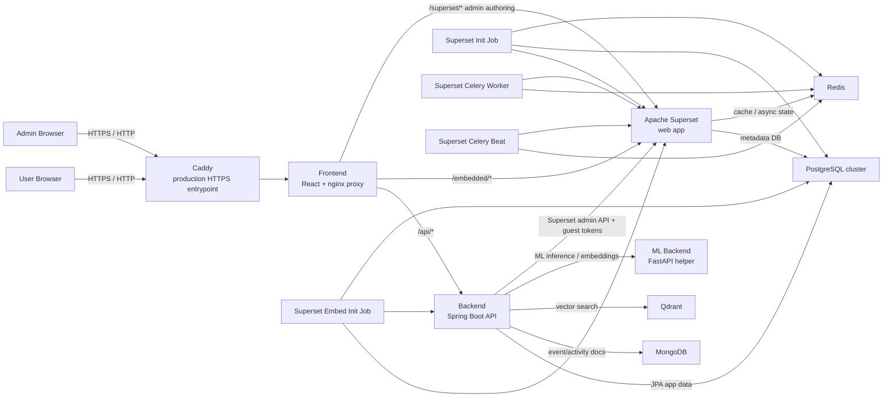

# Architecture

This document describes the current runtime architecture of the application as it exists in this repository.

## Overview

- End users access the React frontend.
- The frontend proxies backend API calls, embedded Superset dashboards, and admin-only Superset authoring routes.
- The backend owns application auth, app APIs, guest-token minting, and embed configuration management.
- Superset remains internal to the stack and is not intended to be exposed directly to users.

## Mermaid Diagram

## Request Flow Notes

### Standard app requests

1. Browser requests hit Caddy in production.
2. Caddy forwards traffic to the `frontend` container.
3. The frontend serves the SPA and proxies `/api/*` to the backend.
4. The backend reads and writes app data in PostgreSQL, MongoDB, and Qdrant.

### Embedded dashboards

1. The frontend loads embedded dashboards through `/embedded/...`.
2. The backend mints Superset guest tokens.
3. The backend also syncs the active app origin into Superset embedded allowlists.
4. Superset serves the embedded dashboard without being exposed as a separate public host.

### Admin Superset authoring

1. Admins use `/admin/superset-graph-builder`.
2. The frontend proxies approved Superset authoring routes.
3. The app's auth guard decides whether the user can access those routes.
4. Superset still runs internally, but the admin experience is surfaced through the app shell.
