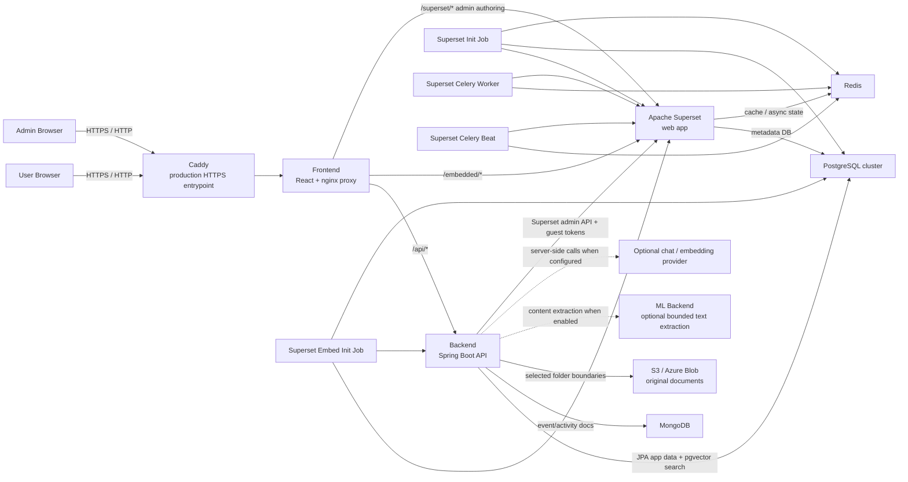

# Architecture

This document describes the current runtime architecture of the application as it exists in this repository.

## Overview

- End users access the React frontend.
- The frontend proxies backend API calls, embedded Superset dashboards, and admin-only Superset authoring routes.
- The backend owns application auth, storage boundaries, search/indexing jobs, optional AI calls, guest-token minting, and embed configuration management.
- Superset remains internal to the stack and is not intended to be exposed directly to users.

In practice, the architecture can be run in two main ways:

- all-in-one:
  the VM carries the frontend, backend, Superset, and the supporting data services
- app host plus offloaded state:
  the VM mainly carries the app logic and proxy layers while PostgreSQL, MongoDB, or storage live elsewhere

The current Redis service is best thought of as part of the Superset runtime side, not as a general app-runtime dependency.

The request and permission model stays the same in both cases.

## Mermaid Diagram

## Request Flow Notes

### Standard app requests

1. Browser requests hit Caddy in production.
2. Caddy forwards traffic to the `frontend` container.
3. The frontend serves the SPA and proxies `/api/*` to the backend.
4. The backend reads and writes app data in PostgreSQL (including pgvector) and MongoDB.

### Storage and content indexing

1. Admins add named S3/Azure connections and select accessible folders. `ADMIN` is the existing super-admin role; this is not a new role name.
2. Storage exposes enabled connections and their accessible selections as named folders. Nicknames stay inside the app.
3. Browse, upload, download, and ZIP requests resolve the saved folder ID and constrain relative paths to its selected prefix. Uploads also require the separate upload grant.
4. PostgreSQL stores folder/document identities and metadata. Original files stay in object storage.
5. If content indexing is enabled, the extraction service supplies bounded text from supported text, PDF, and DOCX files. The backend stores overlapping chunks and vectors in PostgreSQL. Extraction failures retain metadata indexing.
6. Explicit reindexing, upload/discovery, and saved indexing jobs synchronize derived search data. A full reindex removes documents no longer present in storage.

### Search and optional AI

1. Storage exposes ordinary similarity search, scoped to the current folder/path when browsing. The floating bottom-right launcher opens AI chat only when its features and chat model are configured; `/search` remains a dedicated search route. The left navigation has no search item.
2. The backend checks the search feature switch before vector or keyword queries. Launcher visibility is a separate UI switch; disabling AI answers leaves search enabled.
3. Default local feature hashing runs within Kotlin and needs no AI provider, model download, API key, or running ML container. PostgreSQL/pgvector still provides persistence and ranking.
4. Folder, document, and chunk queries join live folder visibility and connection state. If configured embeddings are unavailable, access-checked keyword queries provide ordinary search. Different model identities are never compared as if their vectors were compatible.
5. Optional AI answers retrieve relevant document chunks and send excerpts to the selected chat provider. The backend rechecks access before generation and before returning the answer and source links. Provider failure returns guidance rather than fabricated content.
6. MongoDB events and audit logs remain outside search and AI retrieval. OCR/MongoDB document-search integration is deferred.

### Indexing jobs

`VectorReindexScheduler` checks enabled jobs after application startup, once per minute after each check completes. PostgreSQL stores the schedule, selected IANA timezone, next run, pending-change flag, and last result. Jobs support daily times, weekly day/time, fixed intervals, and the next selected time after file changes. Discovery/upload also queues changed files. Repeated changes do not postpone an existing pending deadline.

These are synchronous application jobs for one backend instance, not Superset Celery jobs. The backend must be running to detect changes and execute a job. Persisted overdue work runs once after startup; new changes discovered after startup queue the next future time. See [search and indexing jobs](search-and-indexing.md).

### Authentication and session flow

1. The browser signs in through `/api/auth/login`.
2. The backend validates credentials and issues the app auth token/session cookie.
3. The frontend uses that app session for normal API traffic.
4. Admin-only proxied Superset authoring routes are checked through the backend admin-access endpoint before the request is allowed through.

### Embedded dashboards

1. The frontend loads embedded dashboards through `/embedded/...`.
2. The backend mints Superset guest tokens.
3. The backend also syncs the active app origin into Superset embedded allowlists.
4. Superset serves the embedded dashboard without being exposed as a separate public host.
5. The viewer lists the available dashboard names, preserves selection in `/dashboards?dashboard=<app-dashboard-id>`, and provides previous/next, reload, and expanded-view controls.

### Admin Superset authoring

1. Admins use `/admin/superset-graph-builder`.
2. The frontend proxies approved Superset authoring routes and canonicalizes several mixed Superset URL shapes into the proxied namespace.
3. The frontend proxy asks the backend whether the current user has admin access before authoring traffic is passed through.
4. Direct non-embed Superset page access is therefore enforced at the proxy layer, not just hidden in the React UI.
5. Superset still runs internally, but the admin experience is surfaced through the app shell.

## User-Facing Surfaces

The main user-visible routes are:

- `/`
  main application shell
- `/dashboards`
  embedded shared dashboards
- `/storage`
  registered storage roots and a nested S3/Azure Blob folder browser (`/items` redirects here)
- `/search`
  dedicated search panel; ordinary search is also available directly in Storage
- `/events`
  event log
- `/admin`
  card-based administration menu; sections provide a back link instead of sidebar child items
- `/admin/users`
  user lifecycle and role management
- `/admin/storage`
  named connections, folder publication, default storage, and indexing jobs (`?tab=vectors`)
- `/admin/ai`
  independent search/launcher/AI switches, content indexing, provider configuration, and connection tests
- `/admin/system`
  health, network boundaries, and runtime/service information previously shown on Home
- `/admin/audit`
  audit history and application backup export
- `/admin/dashboard-links`
  admin-only Superset dashboard selection; Kotlin enables embedding and owns the embed UUID
- `/admin/superset-graph-builder`
  embedded Superset authoring workspace

## Role and Access Model

The effective permission split is:

- authenticated users:
  can sign in, browse accessible folders, download documents/folder archives, run enabled search, and view enabled dashboard embeds allowed for their role
- users with `can_upload_documents`:
  can upload documents and folder trees within an accessible selected storage root; this permission is independent of USER/ADMIN and defaults off
- admins:
  can manage users and upload permissions, items, dashboard embed configs, admin settings, backups, vector reindexing, audit views, and Superset authoring

Important implementation detail:

- hiding links in the frontend is not the security boundary
- the nginx proxy in the frontend container is the real boundary for non-embed Superset route exposure
- `/embedded/...` remains intentionally accessible for allowed application users
- storage visibility and the search feature switch are enforced by backend services, not only by hidden controls

## Service Responsibilities

### Frontend

The frontend does more than serve the SPA:

- serves the React app
- proxies `/api/*` to the backend
- proxies `/embedded/*` to Superset
- proxies approved admin-authoring Superset routes
- enforces admin-only authoring access through `auth_request`
- rewrites some legacy or mixed Superset routes so the embedded admin workspace remains usable
- composes plain admin cards/back navigation, visible dashboard navigation, and the floating search panel

### Backend

The backend is the application control plane:

- authentication and session handling
- admin-only access checks for the proxy
- user management
- item CRUD and shared reads
- dashboard embed configuration
- guest-token minting
- local or external embeddings, pgvector/keyword search, bounded document chunk indexing, and optional sourced answers
- calendar/interval/change-triggered indexing jobs and saved feature controls
- write-only encrypted provider credentials, startup migration, and salted password hashing
- admin settings, audit logs, and backup export

### Superset

Superset has two roles here:

- shared end-user dashboards through the embed flow
- admin-only authoring inside `Superset Graph Builder`

It is treated as an internal dependency rather than the primary public web app.

### Storage and Runtime Services

- PostgreSQL:
  application relational data, configuration, schedule state, extracted chunks, and vectors; Superset metadata uses its separate database
- MongoDB:
  events and audit-style activity documents
- pgvector:
  vector index storage inside the application PostgreSQL database
- Redis:
  Superset cache and Celery coordination
- ML helper:
  optional text/PDF/DOCX extraction, plus a legacy vectorization endpoint unused by default local search
- S3-compatible or Azure Blob object storage:
  application-managed storage roots and original document objects; development profiles are provided for MinIO and Azurite

Today that means:

- the backend does not depend on Redis directly
- Redis remains coupled to the Superset web/worker/beat side of the stack
- a future app-level Redis stack would be an additional architectural concern, not the current default

Folder metadata remains relational and searchable; object storage is the durable document boundary.
[Document processing](document-processing-extension.md) describes implemented text extraction and chunk indexing. OCR, image classification, and an asynchronous indexing worker remain future work. S3-compatible and Azure Blob adapters share the same hierarchical browsing contract.

## Credential boundary

Admin-entered AI keys and both storage credential fields are encrypted with AES-256-GCM before database writes. The wrapping key is configured separately as `APP_SECRETS_ENCRYPTION_KEY`; responses expose configured flags, never saved keys. A startup migration encrypts legacy plaintext/rewraps old ciphertext before seed runners and scheduled jobs. A database with stored credentials needs the matching server wrapping key to start.

Application access passwords use bcrypt at cost 12 with a per-password random salt; hashes do not appear in entity JSON or application exports. Production cookies use Secure, HttpOnly, and SameSite=Lax. See [credential setup and rotation](ai-search-and-secrets.md) and [database backup boundaries](database-layout.md#backups-and-recovery).

## Deployment Boundary Notes

For production, the intended public boundary is:

- Caddy on `80/443`
- frontend behind Caddy
- backend, Superset, and stateful services private to Docker or private network paths

The default Compose posture in this repository now matches that boundary in local and production runs:

- only the frontend is published on the host by default
- backend, PostgreSQL, MongoDB, Redis, Superset, and the ML helper stay on Docker-internal service addresses unless you deliberately re-expose them

If data services are offloaded:

- the logical architecture stays the same
- only the network destination of those backend dependencies changes
- the app VM can be sized more like an application host and less like a full data-and-analytics node

### Document delivery

`DocumentDeliveryService` enforces the global PostgreSQL document policy on the authenticated download and PDF preview routes. `PdfService` uses server-side PDFBox to render bounded page images and create watermarked copies without modifying cloud originals. Folder ZIP downloads transform each PDF before adding it. Disabled downloads reject both object and archive requests; preview permission is independent. Visibility and policy are rechecked before returning processed bytes. See [document access](document-access.md).

### Optional email delivery

`EmailSettingsService` selects an independent environment/admin source. Admin credentials are encrypted by the shared entity converter and participate in wrapping-key rotation. `EmailDeliveryService` validates a single plain-text message and returns optional delivery status; `EmailProviderClient` handles SMTP (including app passwords and externally managed OAuth2 tokens) or Resend/SendGrid/Mailgun HTTP APIs. SMTP enforces TLS for authentication and API requests reject redirects. Provider errors are sanitized. The `ADMIN`-only `/api/admin/email` routes provide settings, test messages, and explicit sends; disabled delivery hides the sending controls and rejects direct sends. This module does not add automatic email to existing workflows. See [email delivery](email-delivery.md).
