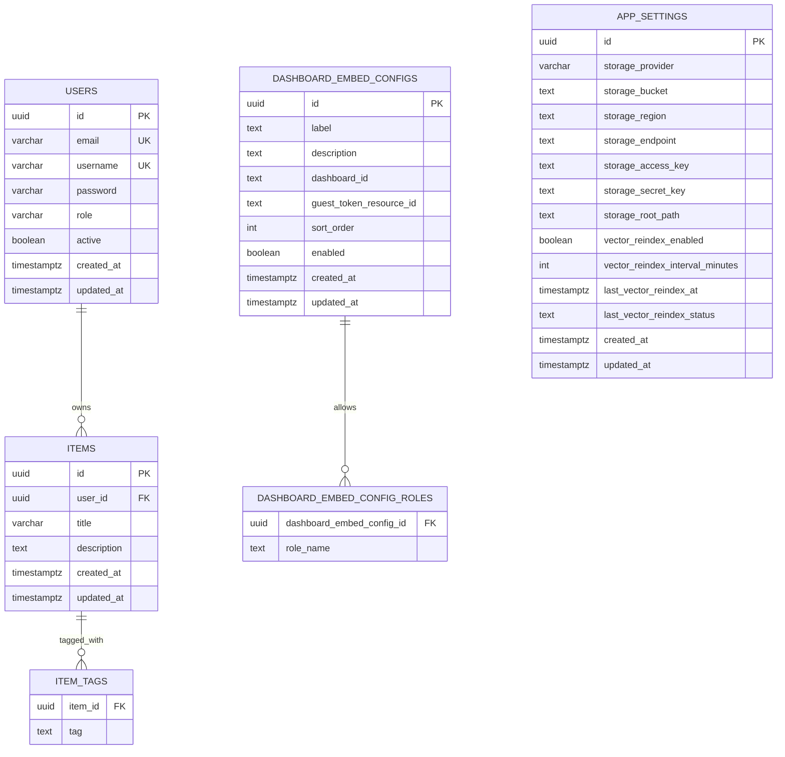
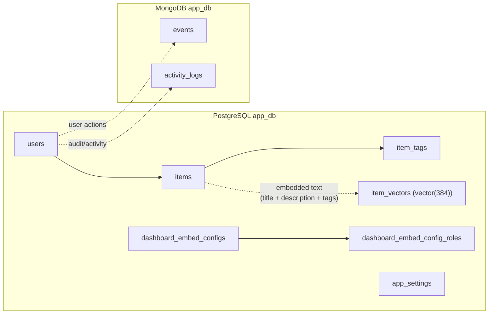

# Database Layout

This document describes the current data layout used by the application stack.

## Overview

The stack currently uses multiple storage systems:

- PostgreSQL with pgvector for application relational data, Superset metadata, and vector search
- MongoDB for event and activity-style documents
- Redis for Superset cache/task coordination

This split is intentional. The business application is not trying to force every concern into one database:

- PostgreSQL handles the relational application model and vector similarity search through pgvector
- MongoDB handles append-style event and audit documents
- Redis supports Superset runtime behavior rather than core business records
- Redis is currently Superset-specific, not a shared application cache layer

## Mermaid Diagram

## Storage Relationship View

## Storage Breakdown

### PostgreSQL

There are effectively two PostgreSQL concerns in the stack:

- `app_db` for the Java/Spring application data
- `superset` for Superset metadata

The application-facing PostgreSQL model is small and centered on a CRUD-style core:

- `users`
- `items`
- `item_tags`
- `dashboard_embed_configs`
- `dashboard_embed_config_roles`
- `app_settings`

#### `users`

- purpose:
  application login identity and role assignment
- key fields:
  `email`, `username`, `name`, `contact_number`, `role`, `active`
- notes:
  the `active` flag drives deactivation without physically deleting the record

#### `items`

- purpose:
  document-folder metadata (the legacy table and API name are retained for compatibility)
- key fields:
  `user_id`, `title`, `description`, `storage_prefix`
- notes:
  each row maps to `{app_settings.storage_root_path}/{id}/`; objects outside that configured path are not exposed by the storage browser; all authenticated users can read registered roots, but only admins can create or mutate them in the current permission model

#### `item_tags`

- purpose:
  simple tag list for each item
- notes:
  stored as a separate collection table keyed by `item_id`

#### `storage_documents`

- purpose:
  persistent identity and processing state for each object discovered beneath a registered root
- key fields:
  `item_id`, `storage_path`, `file_name`, `content_type`, `size_bytes`, `processing_status`, `source_checksum`, `embedding_model`, `vectorized_at`
- notes:
  `(item_id, storage_path)` is unique; current processing status is `METADATA_ONLY`, leaving extraction/OCR/classification for later processors

#### `dashboard_embed_configs`

- purpose:
  runtime-managed configuration for shared embedded dashboards
- key fields:
  `label`, `description`, `dashboard_id`, `guest_token_resource_id`, `sort_order`, `enabled`
- notes:
  this is how the app decides which shared dashboards to surface without hardcoding them into the frontend

#### `dashboard_embed_config_roles`

- purpose:
  allowed application roles per dashboard embed config
- notes:
  allows the same app to expose different shared dashboards to different roles

#### `app_settings`

- purpose:
  admin-managed operational settings
- key fields:
  storage connection fields, `storage_root_path`, vector reindex settings, and last reindex status timestamps
- notes:
  this is operational configuration state, not end-user business content

Notes:

- `items.user_id` references `users.id`
- `item_tags.item_id` references `items.id`
- `dashboard_embed_config_roles.dashboard_embed_config_id` references `dashboard_embed_configs.id`
- `dashboard_embed_configs.dashboard_id` stores the linked Superset dashboard identifier as text
- `dashboard_embed_configs.guest_token_resource_id` stores the embedded resource UUID used for guest-token access
- schema bootstrapping in `schema.sql` also backfills and enforces `users.active`

### MongoDB

Current application document collections:

- `events`
- `activity_logs`

Observed document intent:

- `events` stores app/system events with `userId`, `type`, `payload`, and `createdAt`
- `activity_logs` stores audit-style activity records with `userId`, `action`, resource fields, client metadata, and `timestamp`

Document-model rationale:

- these records are append-heavy
- they are useful for operational visibility and audit trails
- they do not need the same relational lifecycle as core application rows

Seed/bootstrap behavior currently initializes:

- `events`

### pgvector

The backend stores vector search points in the PostgreSQL tables:

- `item_vectors`
- `document_vectors`

Both tables use a `vector(384)` embedding column and an HNSW cosine-distance index.

Current linkage:

- folder rows in `items` are embedded into vectors and stored in `item_vectors`
- the JSONB payload includes `itemId`, `folderId`, `entityType`, `title`, and `storagePrefix`
- object metadata is stored in `storage_documents`, then embedded separately into `document_vectors`
- document payloads identify `entityType=document`, their parent folder, and relative storage path
- search ranks folder and document vectors together
- the backend can rebuild both kinds of vector state through reindexing

Operational note:

- `item_vectors` and `document_vectors` contain derived search data in the same PostgreSQL database
- it can be rebuilt from primary item data rather than treated as the sole source of truth

### Redis

Redis is not a primary business-data store here. It currently supports:

- Superset cache state
- Superset Celery broker/result backend behavior
- async task coordination

Important scope note:

- this Redis instance is currently part of the Superset runtime footprint
- the application backend does not use Redis directly today
- if the broader application later needs Redis, that should be treated as a separate stack concern rather than assumed to be the same service

That means Redis loss is operationally important, but conceptually different from losing the primary relational or document stores.

## Current Data Boundaries

At a high level:

- user, item, and embed-configuration records live in PostgreSQL
- event/audit-style documents live in MongoDB
- vector embeddings live in the PostgreSQL `item_vectors` table
- Superset metadata stays in its own PostgreSQL database within the same Postgres service

Another useful way to think about the boundary is:

- source-of-truth business data:
  PostgreSQL
- source-of-truth event/audit documents:
  MongoDB
- derived search state:
  PostgreSQL with pgvector
- cache/task runtime state:
  Redis

## Persistence and Backup Thinking

Not every store should be treated the same way operationally.

- PostgreSQL:
  high-value source-of-truth data, should be backed up directly
- MongoDB:
  operational and audit history, should also be backed up if those logs matter
- pgvector data:
  useful but rebuildable from item data in this app and covered by PostgreSQL operations
- Redis:
  runtime-oriented, usually recoverable by restarting services and warming caches

If you offload services to managed offerings, these same boundaries still apply even though the physical infrastructure changes.

## Offloaded-Service Interpretation

If PostgreSQL, MongoDB, or storage are moved off the VM:

- the application data model does not change
- only the network location of those stores changes
- the VM becomes much closer to an application host than a full stateful stack node

The current Superset-specific Redis service is the main exception to that simplification: it often still makes sense to leave it beside Superset on the same VM unless you are explicitly decomposing the Superset runtime as well.

That is why the repo can reasonably be deployed either as:

- a compact all-in-one stack
- or a lighter app host with managed stateful dependencies

## Implementation Sources

The current diagram is based on these files:

- [backend/src/main/kotlin/com/starter/model/postgres/Entities.kt](../backend/src/main/kotlin/com/starter/model/postgres/Entities.kt)
- [backend/src/main/kotlin/com/starter/model/mongo/Documents.kt](../backend/src/main/kotlin/com/starter/model/mongo/Documents.kt)
- [backend/src/main/resources/schema.sql](../backend/src/main/resources/schema.sql)
- [docker/postgres/init.sql](../docker/postgres/init.sql)
- [docker/mongo/init.js](../docker/mongo/init.js)
