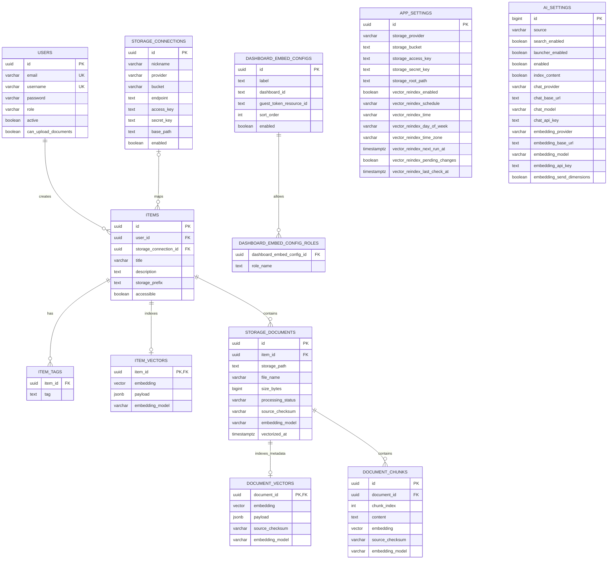

# Database layout

The optional operations suite owns `plugin_timesheets_records`, `plugin_activitywatch_records`, `plugin_timecamp_records`, `plugin_cloud_costs_records`, `plugin_billing_items_records`, `plugin_billing_records` and `plugin_on_call_records`. Each has UUID ownership/project keys, a bounded typed JSON payload, revision, timestamp, kind and a separate encrypted secret column. The shared reviewed store accepts only declared table identifiers and parameterizes request values. Plugin manifests own table access and clear-data behavior. Back these tables up alongside generated PDF bytes, plugin configuration and the external encryption key.

Timesheets retain source IDs, approval/rate snapshots and invoice reservations. ActivityWatch suggestions are private until allocation; TimeCamp mappings belong to administrators. Billing stores profiles, immutable document snapshots, durable source claims, schedule state, encrypted reply bodies and mailbox UID cursors. Source-claim IDs are deterministic across actors, preventing concurrent duplicate charges. Clearing Documents/Timesheets is blocked while Billing references their records. Cloud cost rows are replaceable provider-period snapshots; on-call rows hold rotations, sources and incident state. Disabling/removing a plugin retains its tables and secrets. Explicitly clearing billing removes its financial history/duplicate guards, so export and back up records before using that existing destructive admin operation.

`user_profiles` stores each member’s timezone, normalized private avatar bytes/content version, and optimistic revision. Name and phone remain on `users`; profile APIs cannot change roles or login identity. Include profiles in backups.

Clients/projects use `workspace_clients`, `workspace_projects`, `workspace_work_groups`, and `workspace_project_settings`. Client JSON owns shared contacts; project JSON has `contactSource` (`CLIENT` or `PROJECT`) and its own override list. An empty override is distinct from inheritance. Legacy nonempty project lists read as overrides; empty lists inherit. Project settings contain tags, ordered `sections` (`id`, `name`), and `defaultSectionId`. The existing `workspace_projects.category` column retains stable section IDs; an idempotent schema update drops its former three-value enum check, without changing stored assignments. Settings/project writes coordinate with transaction-scoped shared/exclusive advisory locks so removal cannot race with assignment. Old global `identityContacts` JSON is ignored, without destructive contact-data cleanup; a later settings save writes the supported fields. Validated JSON stores contacts, member/team grants, tags, web links, and storage references; category/lead/client/revision are relational fields. `workspace_project_reports` stores PDF bytes and source board IDs for live access checks. `workspace_work_schedules` stores disabled-by-default job configuration, claims, next/last status, and sprint progress. Include these in backups; metadata exports are not full backups.

Kanban boards retain project/team IDs, a stable ticket counter, and validated JSON for ordered columns with entry/exit policies, workflow transitions/node positions, tickets/tags/subtasks/relationships, epics and sprints. Older JSON uses defaults for new fields. `plugin_settings.revision` adds optimistic locking for atomic activation batches (existing rows start at zero). `plugin_kanban_comments` stores comments, nullable parent comment IDs and mentioned internal member IDs; clearing removes comments/development links before boards. `plugin_kanban_estimation` stores per-project estimation overrides and revisions. Discord, Telegram and Teams own `plugin_<id>_identities` for internal/remote identities, private destinations and revisions. These personal identifiers are excluded from search and removed by plugin clear-data; encrypted configuration remains.

Project extensions own `plugin_jira_projects`, `plugin_figma_files` and `plugin_mermaid_diagrams`. Each stores its project ID, bounded JSON metadata/source, revision and timestamps with project/table access checks. Jira retains aggregate metric snapshots; Figma retains file metadata; Mermaid retains editable diagram source. Include these in database backups. Sprint calendar ranges are virtual entries computed from authorised board JSON rather than duplicated calendar rows.

`workspace_project_repositories` stores approved repository metadata and provider configuration fingerprints. `workspace_project_development_settings` stores per-project feature switches and an optimistic revision. `workspace_project_development_links` stores bounded branch/request/deployment references, optional board/ticket scope, provider snapshots, fingerprints and revisions. Disabled features retain their records. Board-scoped links are filtered by current board membership before display; removed repositories/boards do not grant access through saved links. Jira's existing project payload also retains an optional board ID alongside metric snapshots. Include these tables in database backups.

Runtime extension packages use `workspace_plugin_packages` (descriptor, author metadata, frontend/backend artifacts and normalized artwork, archive SHA-256, install time) and `workspace_extension_security` (global third-party switch, optimistic revision). Binary JAR/image/font artifacts are base64 inside the package file map. `workspace_plugin_invocations` stores short-lived callback token hashes, actor/package/route/method scope, expiry and call counts; completion deletes them and periodic cleanup removes expired rows. Request bodies and raw tokens are not retained. Declared ZIP tables use a fixed host schema: UUID ID/owner, JSONB data, revision, timestamps, search text, and local `vector(1536)`. No uploaded SQL executes. Include packages, security state, encrypted plugin configuration, and owned tables in PostgreSQL backups. See [ZIP packages](plugins/zip-packages.md) and [backend execution](plugins/backend-runtime.md).

Optional extensions use `plugin_settings` (enabled/removal state, roles, search visibility, table policies) and `plugin_kanban_boards` (owner, name, revision, timestamp, validated JSON, local search text/vector). Include these in PostgreSQL backups; metadata JSON export omits them. Disabling retains data. Plugin search is opt-in, with live role and ownership checks. Admins can empty only declared plugin tables with an explicit confirmation; schema and settings remain. The host-managed `workspace_plugin_configuration` stores encrypted configuration JSON and optimistic revisions; it is retained when clearing owned plugin tables. Include it in backups and wrapping-key rotation. See [Workspace plugins](plugins.md).

`plugin_kanban_development_links` stores board/card relationships to approved Git repositories and pull/merge requests with refreshed metadata. `plugin_calendar_events` stores owned local events, revisions, and bounded `details_json` containing document references, participants, and origin label. These references do not copy documents or grant access. Card deadlines remain in board JSON. Shared external calendar overlays are read on demand, while personal sync imports owned events; neither is copied into the search index. These tables are included in PostgreSQL backups. See [Calendar](plugins/calendar.md) and [source-control plugins](plugins/source-control.md).

Personal sync additionally uses `plugin_calendar_connections` (owner, encrypted credential JSON, configuration revision, next/last sync, sanitized status) and `plugin_calendar_sync_links` (owned event/connection relationship, opaque remote ID/revision, acknowledged local revision, remote deletion state). Calendar events retain deletion tombstones, origin, personal privacy, and sync-exclusion flags. Imported personal events and disconnected copies stay private to their owner. Clearing Calendar removes its three tables' contents and personal credentials; provider copies and shared admin configuration are retained.

Workspace branding uses PostgreSQL: `branding_assets` stores logo/favicon PNGs; `branding_preferences` stores the business name, hex colour overrides, background mode/selection/timing, and optimistic revision; `branding_login_images` stores up to five numbered JPEG images with content versions. Image listing queries project metadata without fetching the image bytes. Include all three tables in database backups; the metadata JSON export omits them. See [branding](branding.md).

PostgreSQL stores application identity, storage metadata, feature/provider configuration, indexing jobs, and derived search content. S3/Azure Blob stores original files. PostgreSQL also retains events and audit history; these tables are excluded from document search. Redis supports Superset.

## Stores and ownership

| Store | Contents | Search participation |
| --- | --- | --- |
| PostgreSQL `app_db` | Users, shared folders, connections, settings, document identities/chunks, and pgvector indexes | Folder/document metadata and enabled extracted content |
| PostgreSQL `superset` | Superset's own metadata | Outside application document search |
| S3-compatible bucket or Azure Blob container | Original document objects beneath selected prefixes | Read through authenticated storage adapters for discovery/extraction |
| MongoDB `app_db` | `events`, `activity_logs` | Excluded from search and AI retrieval; integration deferred |
| Redis | Superset cache and Celery broker/results | Outside application search |

## Relational relationships

Vector columns are `vector(1536)`; the diagram omits timestamps and some descriptive fields for readability. Settings tables hold application-wide configuration rather than per-user preferences.

## Identity and storage

`users` contains login/profile data, the stored bcrypt password hash, role, activation state, and independent upload grant. The existing `ADMIN` role provides super-admin configuration access. Deactivation retains the record and denies authentication; the UI does not hard-delete users.

`items` retains the legacy name for shared folder roots. `title` is the in-app nickname, `storage_prefix` is the saved object prefix, and `accessible` controls publication. `user_id` records the creating user; visibility is shared rather than limited to that owner.

- A null `storage_connection_id` identifies an application-managed root on the default connection: `{app_settings.storage_root_path}/{folder-id}/`.
- A non-null reference identifies an explicitly selected prefix on a named S3/Azure connection. `base_path` limits the administrator's folder picker.
- Prefix uniqueness is scoped to each connection, with a separate partial unique index for legacy roots. Matching paths can therefore exist in different buckets/containers.
- Parent/child selections in one connection cannot overlap. A new connection shares no folder automatically.
- Hidden selections and disabled connections are checked before browse/upload/download and again in search SQL. Revocation does not require deleting cached vectors.

`storage_connections` stores nicknames, provider/bucket/container, optional endpoint/region, boundary, enablement, and encrypted credentials. Nicknames never rename cloud objects. Removing a mapped selection removes metadata/index rows and leaves original objects in storage. Location changes are blocked while that connection still has selected folders.

`item_tags` is the current JPA collection table. The initial PostgreSQL bootstrap also contains a legacy array column; application code uses the collection mapping.

## Document and vector state

`storage_documents` identifies each discovered object by unique `(item_id, storage_path)`. It records filename, content type, size, provider modification time, metadata fingerprint (`source_checksum`), model identity, processing state, and last successful vectorization time.

| Processing status | Meaning |
| --- | --- |
| `METADATA_ONLY` | Content indexing is off; metadata is indexed |
| `CONTENT_INDEXED` | Extracted text chunks were indexed |
| `CONTENT_TRUNCATED` | Only the bounded portion of the document was indexed |
| `UNSUPPORTED_FORMAT` | Filename format has no supported extractor; metadata remains searchable |
| `CONTENT_TOO_LARGE` | Size is unknown or above the 5 MiB content-read limit |
| `NO_EXTRACTABLE_TEXT` | Extraction returned no text, such as a scanned PDF needing OCR |
| `CONTENT_UNAVAILABLE` | Extraction/read failed; metadata indexing can still succeed |
| `INDEX_ERROR` | Vector/configuration indexing failed; a later reindex retries |

Three derived search tables use 1536-dimensional vectors and HNSW cosine indexes:

- `item_vectors`: folder title/description/tags and identifying payload.
- `document_vectors`: per-object metadata vector and parent folder/path payload.
- `document_chunks`: ordered extracted content, original-byte SHA-256 checksum, model identity, and vector. `(document_id, chunk_index)` is unique.

Vector columns permit NULL while an upgrade awaits reindexing. `EmbeddingDimensionMigration` transactionally changes legacy column dimensions, clears incompatible vectors/model identities, and marks storage documents for rebuilding without deleting their metadata or extracted text. PostgreSQL rebuilds existing HNSW indexes for the changed column types. Local Kanban and ZIP-plugin vectors are regenerated from saved search text in batches; already-current columns are left alone on later starts.

Document vectors/chunks have cascading foreign keys to their document; documents belong to their selected folder. Full reindexing removes documents missing from storage. Browsing and uploading synchronize discovered objects; normal metadata change detection uses path/name/type/size/modification time. Run a full reindex if bytes changed without changed provider metadata.

Each vector carries an embedding-model fingerprint. Queries only compare matching fingerprints. Default local matching is `local-feature-hash-v3` inside Kotlin; earlier/local or different-provider vectors require reindexing. Keyword fallback can use current metadata and permitted existing chunks without comparing incompatible vectors. Content chunks are excluded immediately when content indexing is disabled.

Both vector and keyword queries join live folder visibility and connection enablement for all result types. AI generation uses content chunks and checks their access before and after the provider call. No event or audit collection is indexed.

## Configuration and schedule state

`app_settings` holds the default storage connection and operational job settings. The service uses the first settings row by creation time. Relevant job columns are:

| Column | Purpose |
| --- | --- |
| `vector_reindex_enabled` | Enables scheduled work; manual reindex remains available when false |
| `vector_reindex_schedule` | `INTERVAL`, `DAILY`, `WEEKLY`, or `ON_CHANGE` |
| `vector_reindex_interval_minutes` | Interval length, 15 to 10080 minutes |
| `vector_reindex_time` | Local `HH:mm`, initially `00:00` |
| `vector_reindex_day_of_week` | Weekly day, initially `FRIDAY` |
| `vector_reindex_time_zone` | Valid IANA timezone, initially `Africa/Johannesburg` |
| `vector_reindex_next_run_at` | Persisted due instant; null while an enabled change job awaits changes |
| `vector_reindex_pending_changes` | Coalesced work awaiting the selected change-job time |
| `vector_reindex_last_check_at` | Most recent change poll |
| `last_vector_reindex_at`, `last_vector_reindex_status` | Last outcome and timestamp |

`ai_settings` uses singleton ID `1`. `source` selects `ENVIRONMENT` or `ADMIN`. It stores independent search, launcher, AI-answer, and content-indexing switches plus separate chat/embedding endpoints, models, and encrypted keys. Environment values are read from server configuration and are not copied into saved admin keys.

`dashboard_embed_configs` and its role collection determine the enabled dashboards visible to each role. The linked Superset dashboard ID and backend-resolved embed UUID are distinct. Selection/order/labels are runtime-managed; the browser does not edit embed UUIDs.

## Credential storage and startup

Storage access/secret fields and AI API-key fields are encrypted TEXT using AES-256-GCM with a fresh nonce per write. JPA converts ciphertext to server-side values; API responses expose configured flags. Password hashes and credentials are excluded from entity JSON/debug output. Wrapping keys stay outside PostgreSQL in the server environment.

Hibernate currently uses `ddl-auto=update`; supplemental [schema.sql](../backend/src/main/resources/schema.sql) runs after JPA initialization to create pgvector objects, indexes, and compatibility changes. `StoredSecretMigration` then encrypts legacy plaintext/rewraps credentials before explicit account/storage bootstrap; scheduled work waits until application startup completes. This is the current startup mechanism, not a versioned Flyway/Liquibase migration system. Existing encrypted rows require the matching wrapping key. See [upgrade and key rotation](deployment.md#upgrading-an-existing-installation).

## Event history and Redis

PostgreSQL tables `events` and `activity_logs` retain existing history APIs and export fields. Events use typed identifiers/timestamps and a JSONB payload. Existing history requires the [legacy importer](history-migration.md). These tables remain outside document search. `document_processing_jobs`, `document_pages`, and page-aware `document_chunks` support [background extraction and external OCR](document-processing-extension.md).

Redis remains a Superset cache/Celery concern. The application backend does not use it for indexing jobs, vector storage, or search sessions.

## Backups and recovery

| Artifact | Contains | Recovery limits |
| --- | --- | --- |
| Admin JSON export v2 | Selected user/profile metadata, folders/connections, document metadata/status, dashboard definitions, non-secret AI/settings/job configuration, events, audit logs | Omits password hashes, credentials/ciphertext, original objects, content chunks, vectors, pending-job runtime state, and per-user upload grants; no application import/restore endpoint |
| PostgreSQL database backup | Relational state, bcrypt hashes, encrypted credential fields, content chunks, vectors, and persisted job state | Stored credentials need the matching separately retained wrapping key |
| Object-storage backup/versioning | Original files and prefixes | Does not restore application nicknames, publication rules, or login identities |
| Wrapping-key backup | Current/required previous server keys | Retain separately from database backups and with restricted access; losing the matching key prevents decryption |

The export identifies itself as `superset-docker-app-backup-v2` and `credentialsIncluded: false`. It is a useful metadata export, not a complete disaster-recovery backup. Derived vectors can be rebuilt from folder metadata and original objects, with extraction/embedding dependencies available. Do not delete primary database records just because vectors are rebuildable.

## Implementation sources

- [PostgreSQL entities](../backend/src/main/kotlin/com/starter/model/postgres/)
- [PostgreSQL history models](../backend/src/main/kotlin/com/starter/model/postgres/History.kt)
- [Supplemental schema](../backend/src/main/resources/schema.sql)
- [First-volume PostgreSQL bootstrap](../docker/postgres/init.sql)
- [Backup export](../backend/src/main/kotlin/com/starter/service/BackupExportService.kt)
- [Search and job guide](search-and-indexing.md)

### Document access settings

`document_access_settings` uses singleton ID `1`: `pdf_preview_enabled` defaults true, `download_mode` defaults `NORMAL` (`NORMAL`, `WATERMARKED`, or `DISABLED`), and `watermark_text` defaults `CONFIDENTIAL`. An absent row uses those defaults; the first admin save persists it. Hibernate creates the table on upgrade. These settings are not included in the existing JSON backup export; use database backups.

### Email settings

`workspace_shared_settings` stores named, versioned incoming-mail and plugin-defined connection profiles: schema ID, display name, enabled flag, AES-GCM-encrypted `data_json`, historical secret-field names, and optimistic revision. Hibernate creates the table; no connection is seeded. Startup key rotation includes its JSON. Billing's legacy IMAPS fields migrate once into a shared profile; explicit consumer bindings are retained in encrypted `workspace_plugin_configuration` under reserved `@shared:` keys. Shared connections are excluded from search and metadata JSON export and survive plugin removal/data clearing. Preserve PostgreSQL and wrapping keys. See [shared settings](plugins/shared-settings.md).

`email_settings` uses singleton ID `1`. It stores `source` (`ENVIRONMENT` or `ADMIN`), `enabled` (initially false), `provider`, sender/reply-to fields, SMTP host/port/security/authentication, API base URL, and Mailgun domain. `smtp_username`, `smtp_password` (also app password/OAuth2 token), and `api_key` are encrypted TEXT columns, never returned by settings APIs. Startup secret rotation includes all three columns. Environment credentials remain outside the row. Hibernate creates the table; an absent row selects the disabled environment defaults. Message bodies, delivery queues, and sent history are not persisted. The existing JSON export excludes this table; use PostgreSQL backups and preserve wrapping keys. See [email delivery](email-delivery.md).

### MFA, webhooks, and protected sharing

Hibernate also creates the following domain tables. They are excluded from JSON export and from search/AI retrieval. Preserve PostgreSQL backups and wrapping keys; 

| Table / columns | Purpose and protection |
| --- | --- |
| `users.session_version`, `mfa_prompt_dismissed` | Security version defaults `0`, optional primary-admin prompt dismissal defaults false. JWT validation checks the live version and MFA claim. |
| `mfa_credentials` | User ID primary key (`id`), encrypted `totp_secret`, `email_enabled`, last accepted TOTP step, JSON recovery-code hashes. |
| `mfa_challenges` | SHA-256 token hash as primary key, user/purpose/security version/expiry, attempts/consumed, encrypted `pending_secret`, HMAC email-code proof, last send time. Five-minute challenges; expired rows cleaned hourly after a grace hour. |
| `security_rate_limits` | Hashed scope/identity/time bucket, attempts and expiry. Atomic PostgreSQL upsert counters, hourly expiry cleanup. |
| `webhook_endpoints` | Name/direction/URL/enabled/authentication plus encrypted `secret`. |
| `webhook_deliveries` | Endpoint, unique delivery key per endpoint, timestamp/status/HTTP status and encrypted JSON `payload`. Maximum 100 per endpoint; seven-day hourly cleanup. |
| `file_share_settings` | Singleton ID `1`: enabled (default true), public origin override, maximum link lifetime (default 168 hours). |
| `file_shares` | SHA-256 link token, sender/folder/path/recipient, salted bcrypt password hash, source-byte fingerprint, filename/pages/created/expiry/revoked/delivery state. No raw PDF or recoverable password is stored. |
| `share_access_grants` | SHA-256 grant as primary key, share ID, expiry of at most 15 minutes. Expired grants cleaned hourly. |

The new MFA/webhook/share repository packages are explicitly included in PostgreSQL repository scanning. Startup wrapping-key migration includes authenticator secrets, pending enrollment secrets, webhook secrets, and webhook delivery payloads. Retention cleanup runs after startup. Email attachments are generated in memory; general email bodies are not retained. The share registry retains metadata, not the attachment bytes. See [MFA](mfa.md), [webhooks](webhooks.md), and [PDF sharing](file-sharing.md).

### Document generation and workflow tables

These tables belong to the optional Documents and Workflows source plugins. Their physical names remain stable to preserve existing records; they are explicitly declared retained tables rather than new plugin-namespaced copies. Startup inserts only missing `plugin_settings` rows, enabling each module when its existing business tables contain records. Explicit disabled/removed rows are never overwritten. See [activation, upgrades and clear-data safeguards](plugins/documents-and-workflows.md).

| Table | Contents |
| --- | --- |
| `document_templates` | Name, optional category metadata (no fixed document types), published flag, structured WeasyCanvas template JSON, typed field/calculation rules, creator/timestamps, optimistic revision. |
| `generated_documents` | Owner, template ID/revision/name, document name/filename, created time/pages/size, resolved values, template snapshot, immutable PDF bytes (`bytea`). Owner/created-time index. |
| `workflow_definitions` | Owner, name, state (`DRAFT`, `READY`, `ARCHIVED`), explicit published flag (false by default), typed graph JSON, attached document UUIDs, created/updated times, optimistic revision. Owner/updated-time index. |
| `workflow_runs` | Private owner and source definition UUID, name/design revision, immutable graph snapshot, current node/status, JSON step history/condition values/document overrides, durable email attempt state/UUID/time, created/updated times, optimistic revision; owner/updated-time index. No PDF/password copies. |

Hibernate creates these tables through the existing upgrade mechanism; there is no Flyway migration system. Admins author workflow definitions and manage generated documents. Runs remain private to their owner, including against other admins. Published ready workflows grant PDFs through reached document/email steps only; unpublishing pauses those grants. Existing ready definitions gain `published=false` during upgrade and are not silently shared. Attachment IDs are validated against available documents on every workflow save, not accepted as proof of access. PDF bytes/snapshots/resolved values are excluded from metadata serialization; library queries fetch metadata only. Template revisions are optimistic concurrency tokens beginning at zero. Editing a template does not rewrite an existing PDF.

Generated PDFs live in PostgreSQL in this first version. They are not automatically mirrored into S3/Azure Blob or added to document search. Template/field data and workflow metadata are access-controlled application records, not credentials encrypted by the secret converter; protect database backups appropriately. PDF passwords are supplied per send and never persisted. The current admin JSON export omits these tables. Preserve PostgreSQL backups for document history and templates; Existing object storage remains unchanged. See [documents and workflows](documents-and-workflows.md).

### Notification tables

`notification_settings` stores one versioned JSON configuration for global method switches and per-type rules/templates; no row is seeded. `notification_preferences` stores versioned per-member method choices; absence means use administrator defaults. `notification_deliveries` stores UUID, notification/method IDs, optional recipient account UUID, masked recipient hint, status/timestamps, and a unique hashed idempotency key. Created-time and recipient/time indexes support bounded history queries. Claims commit before provider I/O; completed metadata is retained for 90 days. Message bodies, HTML, codes, full addresses, and provider credentials are not copied into delivery records. These tables are excluded from document/vector search and metadata JSON backup exports. Preserve PostgreSQL backups. Provider credentials remain in the existing encrypted email/plugin settings.  See [Notifications](notifications.md).

### Access controls and role migration

`workspace_artwork` also stores client logos under `client:<uuid>` with separate image versions/revisions. Client contact JSON now includes a free-text relationship `role` beside the existing `position`; missing roles deserialize as empty. The global user role `BUSINESS_MANAGER` is stored in the existing string role column, maps to member plugin policies, and does not imply administrative or project-wide visibility. No contact/logo reseeding is performed.

`workspace_navigation_settings` stores singleton ordered menu/submenu IDs and an optimistic revision. `workspace_artwork` stores scoped project/admin category icon names, normalized PNG bytes, image version and revision. `workspace_project_repositories` stores project/provider repository relationships, sanitized metadata/check time, configuration fingerprint and revision, with a unique project/provider/path constraint. These tables persist across upgrades, are excluded from vector search and the metadata JSON export, and need PostgreSQL backups. They contain no provider tokens; provider configuration remains encrypted in its existing table.

`access_policy` stores singleton ID `1`, `policy_json` text, and an optimistic `revision`. The JSON contains role feature caps, per-member view/storage grants and exclusions, and business-protected paths. `account_role_migrations` records the one-time promotion of the initial active admin. `users.role` supports `SUPER_ADMIN`, `ADMIN`, `USER`, and `EXTERNAL`; changes increment `session_version`. Preserve all these records in database backups. See [access controls](access-controls.md).
