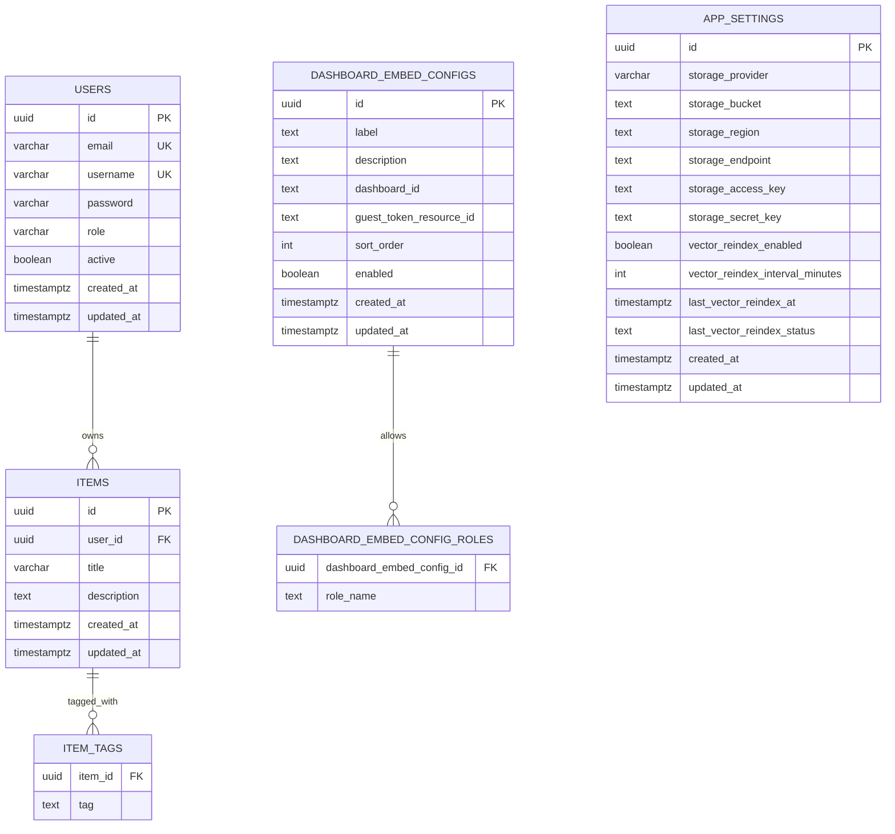
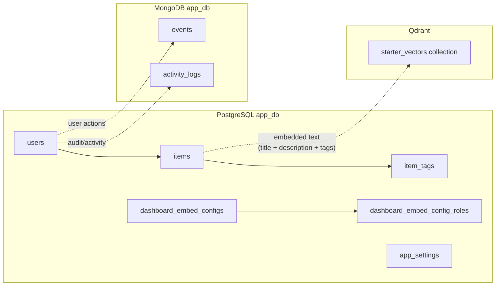

# Database Layout

This document describes the current data layout used by the application stack.

## Overview

The stack currently uses multiple storage systems:

- PostgreSQL for application relational data and Superset metadata
- MongoDB for event and activity-style documents
- Qdrant for vector search storage
- Redis for Superset cache/task coordination

## Mermaid Diagram

## Storage Relationship View

## Storage Breakdown

### PostgreSQL

There are effectively two PostgreSQL concerns in the stack:

- `app_db` for the Java/Spring application data
- `superset` for Superset metadata

Current application tables visible in this repository:

- `users`
- `items`
- `item_tags`
- `dashboard_embed_configs`
- `dashboard_embed_config_roles`
- `app_settings`

Notes:

- `items.user_id` references `users.id`
- `item_tags.item_id` references `items.id`
- `dashboard_embed_config_roles.dashboard_embed_config_id` references `dashboard_embed_configs.id`
- `dashboard_embed_configs.dashboard_id` stores the linked Superset dashboard identifier as text
- `dashboard_embed_configs.guest_token_resource_id` stores the embedded resource UUID used for guest-token access

### MongoDB

Current application document collections:

- `events`
- `activity_logs`

Observed document intent:

- `events` stores app/system events with `userId`, `type`, `payload`, and `createdAt`
- `activity_logs` stores audit-style activity records with `userId`, `action`, resource fields, client metadata, and `timestamp`

Seed/bootstrap behavior currently initializes:

- `events`

### Qdrant

The backend stores vector search points in a Qdrant collection named:

- `starter_vectors`

The collection is managed by backend startup logic and is used for semantic search over indexed app data.

Current linkage:

- `items` are embedded into vectors and stored in `starter_vectors`
- the current Qdrant payload includes `itemId` and `title`

### Redis

Redis is not a primary business-data store here. It currently supports:

- Superset cache state
- Superset Celery broker/result backend behavior
- async task coordination

## Current Data Boundaries

At a high level:

- user, item, and embed-configuration records live in PostgreSQL
- event/audit-style documents live in MongoDB
- vector embeddings live in Qdrant
- Superset metadata stays in its own PostgreSQL database within the same Postgres service

## Implementation Sources

The current diagram is based on these files:

- [backend/src/main/kotlin/com/starter/model/postgres/Entities.kt](../backend/src/main/kotlin/com/starter/model/postgres/Entities.kt)
- [backend/src/main/kotlin/com/starter/model/mongo/Documents.kt](../backend/src/main/kotlin/com/starter/model/mongo/Documents.kt)
- [backend/src/main/resources/schema.sql](../backend/src/main/resources/schema.sql)
- [docker/postgres/init.sql](../docker/postgres/init.sql)
- [docker/mongo/init.js](../docker/mongo/init.js)
