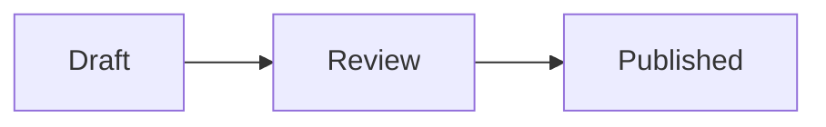

# Knowledge base

The optional **Knowledge base** plugin provides shared, linked Markdown documentation. Enable it in **Administration > Plugins** after rebuilding the backend, frontend, and PDF renderer images. No documents or export permissions are seeded. Its workspace route is `/plugins/knowledge`.

Members with plugin access can read the page tree and rendered documents. The plugin's **Shared documentation pages** table policy controls editing: remove `USER` from its write roles to make ordinary members read-only. Documents have parent pages, stable UUID links, uploaded images, and optimistic revisions; concurrent changes return HTTP 409. Move child documents before deleting a parent. The database stores Markdown and images; disabling the plugin retains them.

## Writing documents

Use **New document** or **Edit document**, or import a UTF-8 `.md`/`.markdown` file. The editor supports CommonMark and tables, including headings, lists, quotations, fenced code, and links. **Preview document** shows the rendered content before saving. Raw HTML is displayed as text.

Use **Insert link** or **Copy Markdown link** for `[Page title](wiki:PAGE_UUID)`. To link to a heading, use `wiki:PAGE_UUID#heading-name`; same-page links use `#heading-name`. Heading slugs use lowercase words separated by hyphens, with `-2`, `-3`, etc. for repeated headings. Uploaded PNG/JPEG/WebP images use normal Markdown, for example ``. Each page supports eight images totalling 1 MiB and 100,000 Markdown characters. External image URLs and filesystem paths are rejected.

Mermaid diagrams use fenced blocks:

````markdown

````

Diagrams render locally in the browser with strict Mermaid settings. Runtime configuration directives, remote images, and active resources are excluded. Neither page rendering nor PDF export calls an LLM.

## Export permissions

An administrator opens **Knowledge base > Export permissions & cover**, selects individual active accounts, and saves **Export permissions**. **Nobody can export by default, including administrators.** Plugin access and document editing do not grant export permission. Permission changes save independently of cover validation and PDF service availability.

The backend checks current account activation, plugin availability, table read permission, the individual export grant, and global document download policy before preparing/rendering an export. It checks authorization and document revisions again after rendering. Revocation, policy changes, changed or deleted selected pages, or plugin disablement suppress the completed download. Global disabled downloads block export; watermarked downloads apply the configured watermark. The cover preview contains example cover data only and is restricted to administrators.

## PDF books

An authorized member chooses **Export PDF book**, selects 1–50 documents, orders them with the up/down controls, and enters a book title. Children are selected individually. The PDF contains:

- The saved HTML/CSS cover and uploaded cover images.
- Linked contents with actual page numbers for the selected documents and their first two heading levels.
- Selected documents in the requested order, including uploaded images and locally rasterized Mermaid diagrams.
- Physical page numbers on every page, including the cover and contents.
- PDF outline bookmarks for document headings, plus a **Pages** branch with a destination for every physical page.

Links between selected documents become internal PDF destinations. Omitted-document links have no PDF destination. Books are bounded to 200 pages, 10 MiB of PDF output, 32 Mermaid diagrams, and approximately 3.6 MiB of source payload including images. Choose fewer documents or smaller images for larger collections. A document changed after opening the selection must be refreshed before export.

The cover editor follows the report cover workflow: download/upload HTML, upload images by filename, preview one A4 page, and save. It has its own design, independent of report covers. Text placeholders are `{{title}}`, `{{documentCount}}`, `{{siteName}}`, `{{companyName}}`, and `{{generatedAt}}`; `{{siteLogo}}` embeds the workspace logo. Leave the bottom 10 mm clear for page numbering. External resources are never fetched by the renderer.

The browser prepares Mermaid PNGs for the exact selected revisions. The server loads saved Markdown/images, requires the complete source-bound diagram key set, normalizes raster inputs, resolves selected-page links, and calls the bounded internal PDF worker. Generated books are returned directly and are not stored as a separate document library.

## Storage and API

The manifest declares `plugin_knowledge_pages` and `plugin_knowledge_settings`. Preserve them in PostgreSQL backups; the metadata JSON export omits plugin business data. The host clear-data operation empties both tables, removing pages, images, covers, and all export grants. This module does not contribute document contents to AI chat or workspace search.

All routes are under `/api/plugins/knowledge` and use the standard plugin interceptor:

| Route | Purpose |
| --- | --- |
| `GET /status` | Current editing/export/admin permissions |
| `GET /pages`, `GET /pages/{id}` | Page tree metadata and one rendered/source page |
| `POST /pages`, `PUT /pages/{id}`, `DELETE /pages/{id}?revision=N` | Versioned page mutations |
| `POST /preview/{id}` | Render a Markdown draft |
| `GET /settings`, `PUT /settings` | Administrator cover/settings view and validated cover save |
| `PUT /settings/exporters` | Administrator export allowlist update without rendering |
| `POST /settings/cover/preview` | Administrator sample cover PDF |
| `POST /exports/prepare` | Authorized selected revision/diagram preparation |
| `POST /exports` | Authorized selective PDF download |

Run backend `Knowledge*Test`, the frontend production build, and `python -m unittest discover -s tests -v` from `weasy-renderer/` with its locked dependencies and Pango installed.
