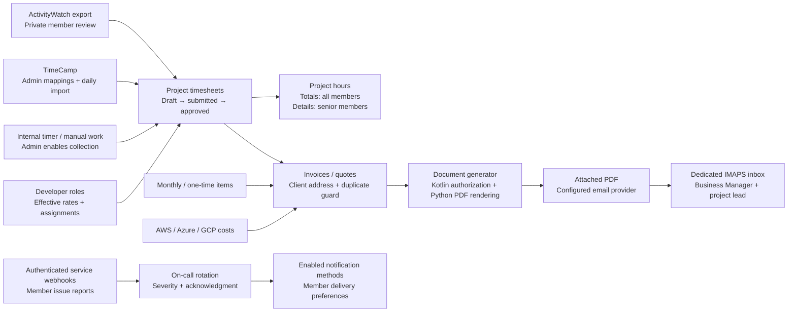

# Billing, time and service operations plugins

These seven bundled plugins are separately optional, start disabled, retain data across app upgrades, and use the normal plugin access/table controls. Enable them in **Administration → Plugins**. Their shortcuts appear in the **Operations** admin category. No provider credentials, business records or schedules are seeded.

| Plugin | Purpose | Required / optional connections |
| --- | --- | --- |
| `cloud-costs` | AWS, Azure and Google Cloud costs mapped to local projects | Optional invoice source |
| `billing` | Client billing addresses, invoices, quotes, PDF delivery, replies and schedules | Requires `documents`; extends `billing-items`, `timesheets`, `cloud-costs` |
| `billing-items` | Recurring flat charges, effective-dated developer roles/rates and assignments | Extends `billing` and `timesheets`; flat items work independently |
| `timesheets` | Shared project time ledger, internal timer/manual entry and approval | Optional billing source |
| `activitywatch` | Member-controlled ActivityWatch export import and allocation | Requires `timesheets` |
| `timecamp` | Administrator-controlled mappings and daily imports | Requires `timesheets`; administrator access by default |
| `on-call` | Weekly rotations, incident reports, monitor webhooks and escalation | Extends installed notification providers; AI optional |

See [time tracking](time-tracking.md), [billing](billing.md), [cloud costs and on-call](cloud-and-on-call.md), and the [API reference](../api.md#operations-plugin-apis).

The first version creates billing documents and records their payment status. It does not charge a payment card, reconcile bank transactions, file taxes, or replace an accounting ledger. Cloud totals remain in their provider currency and may be revised by the provider. No currency conversion is inferred.
