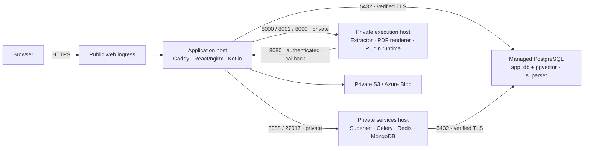

# AWS, Azure and GCP Terraform deployment

The Terraform modules deploy a split stack with managed PostgreSQL and three Linux hosts. They provision the network, private connectivity, database backups, identities and host bootstrap. Use this guide for a fresh installation. Existing installations need the [migration procedure](#existing-installations) before applying these modules.

## Layout

| Tier | Runs here | Access |
| --- | --- | --- |
| Application | Caddy, React/nginx and one Kotlin backend | Public HTTPS; private backend callback from the runtime host |
| Private services | Superset web/init/Celery/beat, Redis and MongoDB history | Superset and MongoDB accept traffic only from the app host; Redis stays inside Docker |
| Private runtime | WeasyCanvas/WeasyPrint renderer, content extractor, plugin runner and Python/Kotlin worker images | Only the app host reaches their API ports |
| Managed PostgreSQL | Separate application and Superset databases/users, pgvector | Private endpoint; TLS with CA verification; no runtime-host database access |
| Object storage | AWS S3 or Azure Blob; separately configured S3/Blob for GCP | Authenticated access; original files stay outside the app host |

The app and Superset use different database passwords. The database administrator password is kept on the services host for the initialization job, and is absent from app/runtime host settings. The runtime host receives only its service tokens, plus nonsecret connection information. The plugin runner controls Docker on that host; treat it as a privileged service.



This separates workloads and adds managed database recovery; it is not a fully highly available application. Each host role is a single VM, and MongoDB/Redis are self-managed. The backend's in-process schedulers currently require one backend instance. Do not add backend replicas without coordinating jobs. Inter-host application traffic uses HTTP on the restricted private network; database traffic and public browser traffic use TLS.

## 1. Prepare tools, a repository and a domain

Use Bash on Linux/macOS/WSL or a cloud shell for the commands below. Install Git, Python 3, Terraform **1.10 or later**, and your cloud CLI. CI pins Terraform 1.16.5 and validates the checked-in provider locks. Native PowerShell can run Terraform too; replace `cp` with `Copy-Item` and Bash `export NAME=value` with `$env:NAME = "value"`.

Have a billed cloud account/project, permission to create the resources below, a hostname you control, and enough quota for three VMs plus the database/standby, disks, IPs and outbound networking. NAT, managed databases, standby capacity and optional Bastion are billed even when users are idle. Check region/SKU availability before applying.

Clone your own repository and choose a release branch/tag containing these deployment files. Cloud-init clones that same repository/ref on every host. The automated bootstrap expects a public HTTPS repository. Private repositories need a separately designed authenticated checkout; putting a token inside `repository_url` would place it in state and VM metadata.

## 2. Choose and authenticate a cloud

### AWS

```bash
aws configure sso
aws sso login --profile YOUR_PROFILE
export AWS_PROFILE=YOUR_PROFILE
aws sts get-caller-identity
cd infra/aws
cp terraform.tfvars.example terraform.tfvars
```

Run from the repository root before the `cd`. The authenticated identity needs permission for EC2/VPC/networking, IAM instance roles, RDS PostgreSQL and S3. Use your organization's scoped deployment role; do not put cloud access keys in tfvars.

Edit `infra/aws/terraform.tfvars`:

- Set `repository_url`, `repository_ref`, `app_domain`, `acme_email`, `ssh_public_key` and a restricted `admin_cidr` (normally your public IP with `/32`).
- Choose `aws_region`, a non-overlapping `vpc_cidr`, and app/service/database sizes if the defaults do not fit.
- Keep `database_high_availability = true` for RDS Multi-AZ unless you deliberately accept a single database instance.

Terraform creates a dedicated VPC, public app subnet, private services subnet, two isolated database subnets in separate availability zones, an internet gateway, explicit route tables, an app Elastic IP and a NAT gateway for the private hosts. App SSH is restricted to `admin_cidr`; private-host SSH is reached through that app host. Database ingress uses source security groups; the runtime host is excluded.

RDS PostgreSQL 17 is private, encrypted at rest, requires TLS and retains 14 days of automated backups. Deletion protection and a final snapshot are enabled. The app alone receives the prefix-scoped S3 instance role. Buckets block public access and reject insecure transport.

### Azure

```bash
az login
az account set --subscription YOUR_SUBSCRIPTION_ID
export ARM_SUBSCRIPTION_ID="$(az account show --query id --output tsv)"
cd infra/azure
cp terraform.tfvars.example terraform.tfvars
```

The deployment identity needs resource provisioning rights plus permission to assign the Blob data role. Ensure the Compute, Network, Storage and PostgreSQL resource providers are registered in the subscription.

Edit `infra/azure/terraform.tfvars`:

- Set the repository/ref, hostname, ACME email and SSH public key.
- The example enables billed Standard Bastion. Keep it enabled for administration without a VPN, or disable it and supply `admin_cidr` with an actual private VPN/peering path.
- Choose `location`, a non-overlapping `vnet_cidr`, VM sizes and `database_sku`.
- PostgreSQL defaults to zone-redundant HA with `database_zone = "1"` and `database_standby_zone = "2"`. Choose supported zones/SKUs in your region. Set `database_high_availability = false` only when that reduction in availability is intentional.

All three VM NICs are private. A Standard load balancer forwards only HTTP/HTTPS to the app, with explicit outbound SNAT for that host. Services/runtime use separate subnets and a NAT gateway. NSGs override Azure's broad default VNet ingress with the required source/port rules. Bastion can administer all three VMs.

PostgreSQL Flexible Server 17 uses a delegated subnet and linked private DNS zone, has public network access disabled, TLS required, a pgvector/UUID extension allowlist and 14-day backups. A CanNotDelete resource lock guards accidental deletion outside a reviewed Terraform teardown. The app managed identity receives access to the private Blob container. [Azure private PostgreSQL networking](https://learn.microsoft.com/en-us/azure/postgresql/network/concepts-networking-private) describes the delegated subnet/DNS requirements.

### GCP

Create or select an existing Google Cloud project and attach billing first. Then:

```bash
gcloud auth login
gcloud config set project YOUR_PROJECT_ID
gcloud auth application-default login
gcloud services enable serviceusage.googleapis.com cloudresourcemanager.googleapis.com
cd infra/gcp
cp terraform.tfvars.example terraform.tfvars
```

Terraform uses Application Default Credentials; signing in to the CLI alone is not enough in a local shell. Cloud Shell already supplies ADC. Prefer workload identity/impersonation for automation rather than downloaded service-account keys. See [Google's Terraform authentication guide](https://docs.cloud.google.com/docs/terraform/authentication).

The deploying identity must be able to enable APIs, provision Compute/VPC/Cloud NAT and Cloud SQL/private service access, create/attach service accounts, and change the specific project/instance/service-account/IAP IAM bindings in this module. Have your cloud administrator grant scoped permissions for these actions. No cloud project, billing account or organization-wide role is created by the module.

Edit `infra/gcp/terraform.tfvars`:

- Set `project_id`, repository/ref, hostname and ACME email.
- Set `admin_members` to explicit IAM users/groups, for example `["user:owner@example.com"]`. These are **cloud SSH administrators with sudo**, independent of Meshable Ops accounts. Do not add ordinary app members here.
- Select matching `region`/`zone`, app/service machine types and `database_tier`.
- Choose non-overlapping `subnet_cidr`, `private_subnet_cidr`, and `database_peering_address` (a reserved `/16` base address). Defaults use `10.44.1.0/24`, `10.44.2.0/24` and `10.45.0.0/16`.
- Keep VM `deletion_protection` and regional database HA enabled unless making a deliberate operational change.

Terraform creates a custom VPC, app/private subnets, an explicit internet route, static app IPv4, Cloud Router/NAT for private hosts, separate unprivileged host service accounts, and private service access to Cloud SQL. The services/runtime VMs have no external IP. Cloud SQL PostgreSQL 17 has no public IPv4, regional HA by default, 14 retained backups and seven days of point-in-time logs. Both Terraform and Cloud SQL deletion protection are enabled.

SSH uses OS Login through IAP. The firewall accepts port 22 only from Google's IAP range, and tunnel IAM bindings are limited to port 22. Selected administrators receive instance-level OS Admin Login/IAP access, service-account attach permission and project Compute Viewer for discovery. Cross-organization users can need a separately granted organization OS Login External User role. [IAP access](https://docs.cloud.google.com/iap/docs/using-tcp-forwarding) and [OS Login setup](https://docs.cloud.google.com/compute/docs/oslogin/set-up-oslogin) explain those requirements.

Cloud SQL's per-instance CA is installed on app/services hosts and checked with `verify-ca`; its private IP is used rather than a hostname. Egress rules allow database access only from the app/services identities. See [Cloud SQL TLS modes](https://docs.cloud.google.com/sql/docs/postgres/configure-ssl-instance).

This deployment adds GCP hosting, not a native Google Cloud Storage adapter. Connect an existing S3-compatible or Azure Blob location in Administration when you need original-file storage. Google Drive is a separate optional integration.

## 3. Create private bootstrap inputs

Stay in your chosen `infra/aws`, `infra/azure` or `infra/gcp` directory:

```bash
python3 ../../deploy/github/setup-terraform-secrets.py --admin-email owner@example.com
```

Enter and confirm a unique app admin password at the private prompt (at least 14 characters, at most 72 UTF-8 bytes). The helper creates `bootstrap.auto.tfvars.json` in **that module directory** with the initial `SUPER_ADMIN`, distinct database/service secrets and a persistent 32-byte wrapping key. Terraform automatically loads this filename. The helper creates new files only; do not run it to rotate an existing installation.

Keep the two input files together:

| File | What belongs here |
| --- | --- |
| `infra/PROVIDER/terraform.tfvars` | Repository/ref, domain, region, network, cloud admin access and sizing |
| `infra/PROVIDER/bootstrap.auto.tfvars.json` | Initial app credentials, database passwords, JWT/Superset keys and runtime/wrapping tokens |
| Cloud CLI/ADC/profile store | Cloud login credentials, outside the repository |
| Remote Terraform backend | Encrypted, access-controlled Terraform state with locking |
| VM `/opt/contract-app/.env.production` | Generated settings for that VM's role; used by Docker Compose |
| VM `/etc/meshable-ops/environment` | Original cloud-init environment copy; protect alongside the runtime file |

The helper uses mode `600` on POSIX. On Windows, keep these files in an account-private folder and restrict NTFS permissions; POSIX modes do not configure Windows ACLs. Both tfvars variants, state, saved plans and backend configuration files are ignored by Git. Ignoring a file does not encrypt it. Bootstrap passwords also exist in Terraform state and cloud-init metadata; cloud administrators and processes with VM metadata access must be trusted.

You can instead supply Terraform `TF_VAR_*` values from a protected secret manager/CI environment. Do not define the same secret in an auto-loaded file and expect an environment variable to override it; tfvars files have higher precedence. The modules do not provision a cloud secret manager.

## 4. Configure state, review and apply

For team/production use, configure an encrypted remote backend with locking before the first apply. Each cloud directory includes backend examples. Create a separate private state bucket/container with versioning and restricted administrator access first; these modules cannot store their own initial state in a resource they have not yet created. Authenticate with your cloud identity and grant the required state read/write/lock access. Application object storage is not a state backend.

In the selected module directory:

```bash
cp backend.tf.example backend.tf
cp state.tfbackend.example state.tfbackend
```

Edit `state.tfbackend` with your **existing** state storage names/location. AWS uses encrypted S3 state and native S3 lockfiles (Terraform 1.10+); Azure uses a Blob lease with Entra authentication; GCP uses GCS locking. Keep credentials out of these files and command history. See the official [S3](https://developer.hashicorp.com/terraform/language/backend/s3), [Azure Blob](https://developer.hashicorp.com/terraform/language/backend/azurerm) or [GCS](https://developer.hashicorp.com/terraform/language/backend/gcs) instructions for storage creation and permissions.

```bash
terraform init -backend-config=state.tfbackend
terraform fmt -check -recursive
terraform validate
terraform plan -out=deployment.tfplan
terraform apply deployment.tfplan
terraform output
```

Review replacements, subnets, routes, IAM, HA settings and costs in the plan before applying. Keep the saved plan private: sensitive values can still be inside it. If you started with local state, use the backend's documented `terraform init -migrate-state` process rather than copying state by hand.

`apply` completion means infrastructure was created; cloud-init builds and initializes services afterward. No app/database credentials are printed as Terraform outputs. No DNS zone/domain or real outgoing email is created for you.

## 5. Point DNS at the web endpoint

In the DNS provider for your domain, set the app hostname's A record to:

```bash
terraform output -raw public_ip
```

Remove an unrelated AAAA record unless you have configured working IPv6. Allow HTTP/HTTPS through any additional organization/host firewall. Caddy uses port 80 for certificate issuance and redirects and serves the workspace over HTTPS on 443. Azure's output is the load balancer address; AWS/GCP use the app's reserved address.

## 6. Verify all three hosts

AWS: connect to `ubuntu@PUBLIC_IP` with the matching private SSH key from `admin_cidr`. Use `terraform output private_hosts` for the private addresses, then connect to services/runtime through the app jump host:

```bash
ssh -J ubuntu@PUBLIC_IP ubuntu@PRIVATE_SERVICE_IP
```

Azure: use Bastion for each VM, or your existing private network. App VM ID is `terraform output -raw vm_id`; the other IDs are in `terraform output private_vm_ids`:

```bash
az network bastion ssh \
  --name "$(terraform output -raw bastion_name)" \
  --resource-group "$(terraform output -raw resource_group)" \
  --target-resource-id YOUR_TARGET_VM_ID \
  --auth-type ssh-key --username appadmin --ssh-key ~/.ssh/id_ed25519
```

GCP: the module emits an app `ssh_command`. Use the matching name from `terraform output instance_names` for each private role:

```bash
gcloud compute ssh INSTANCE_NAME --project=YOUR_PROJECT_ID --zone=YOUR_ZONE --tunnel-through-iap
```

On **each** VM:

```bash
sudo cloud-init status --wait
cd /opt/contract-app
sudo python3 deploy/terraform/start.py --role services
```

Replace `services` with that VM's actual role (`services`, `runtime` or `app`). The helper reads the existing private file, validates required role settings, installs the PostgreSQL trust bundle if needed and starts only that role. Rerunning it preserves credentials and named Docker volumes. Bring up services and runtime before checking the app. Inspect `sudo tail -n 100 /var/log/cloud-init-output.log` for a failed package download/checkout/build; keep logs private.

Compose project names are `meshable-app`, `meshable-services` and `meshable-runtime`. To inspect a role directly, use all three files:

```bash
sudo docker compose --project-name meshable-services --env-file .env.production \
  --profile services -f docker-compose.yml -f docker-compose.prod.yml \
  -f deploy/terraform/compose.split.yml ps --all
```

The services host runs a PostgreSQL initialization job before Superset: it creates missing roles/databases/extensions and read access for Superset. It preserves existing database passwords. A failed job must be fixed before app startup is considered successful. The managed database admin password remains in this host's root-only environment for future initialization/maintenance; protect its backups accordingly.

From your client:

```bash
curl --fail https://YOUR_HOSTNAME/api/health
```

Sign in at the real HTTPS hostname using the app email/password you chose. Superset's authoring password is separate. Enroll MFA, configure named file connections/access, enable required plugins, and configure email/AI/jobs only when ready. Optional AI and email are not prerequisites for starting the app.

## 7. Save optional environment settings

For environment-managed email, AI or identity providers, edit **the app VM's** `/opt/contract-app/.env.production` with `sudoedit`. Keep mode `600`; follow the variable names in [environment settings](deployment-environment.md). Then rerun `sudo python3 deploy/terraform/start.py --role app`.

For app-managed settings, use Administration and keep the wrapping key. Do not put SMTP/API passwords in React/Vite variables, images, tfvars committed to Git, or GitHub repository variables. Admin-saved credentials are encrypted in PostgreSQL.

Edit the role's live environment file for operations; changing Terraform cloud-init inputs is not an in-place settings editor. Keep an encrypted recovery copy and reconcile intentional configuration changes before replacing a host so the bootstrap does not restore stale settings. See [configuration and key recovery](deployment-environment.md).

## 8. Update and back up

Take a tested database recovery backup, MongoDB backup, object backup and encrypted copies of role environments/keys before updating. Managed PostgreSQL backups do not include MongoDB, original files, plugin worker images or Caddy's certificate volume.

Fetch the same reviewed release on all three hosts. Update private services, then runtime, then app, rerunning that role's `start.py` after selecting the revision. App schema updates happen at backend startup; do not run old/new app revisions concurrently against a changing schema. Runtime releases must include both worker image builds. Preserve project names and volumes; never use `down -v` as an update command.

The existing [GitHub Actions SSH release job](github-deployment.md) deploys a **single-host** Compose stack. It does not orchestrate these split roles, managed database initialization or IAP/Bastion. Do not point it at a split host unchanged. Use the role commands above or build a reviewed multi-host release pipeline with private runner connectivity. The shared CI validates all three Terraform modules and split Compose; it never applies infrastructure.

## Existing installations

These modules are not an automatic migration from the previous all-in-one VM templates. Plan a maintenance window and restore into a separately provisioned split deployment:

1. Back up/export app and Superset PostgreSQL databases, roles, MongoDB, original objects, plugin data and every original wrapping/service key.
2. Preserve the old stack and volumes until recovery and data checks pass. Review the Terraform plan: AWS cloud-init changes now replace VMs, and Azure custom data changes can also replace VMs. GCP metadata changes do not reliably rerun first-boot setup.
3. Restore databases into the managed server with the correct owners, pgvector/UUID extensions and separate app/Superset credentials. A new password in Terraform does not rotate a role created by the initialization job.
4. Restore MongoDB on the private services host; point the app at the new endpoints and retain the original wrapping key so encrypted settings and ZIP plugin records remain readable.
5. Verify permissions, files, reports, dashboards, plugin execution, email and scheduled jobs before changing DNS. Keep a rollback plan that includes database/schema changes.

Infrastructure deletion also needs review. RDS requires deletion protection to be disabled deliberately and takes its configured final snapshot; choose a new final snapshot name if a prior one exists. Azure's lock can be removed by a reviewed Terraform teardown. GCP requires both Terraform and Cloud SQL deletion protection to be disabled deliberately. Retained AWS/GCP disks can keep incurring charges and are not automatically reattached/restored to replacements. Terraform state is not an application backup.

## Checks and troubleshooting

Run `terraform test` in each initialized cloud module for mocked network, storage and database assertions. No cloud account or billed infrastructure is used by those tests. Run `python3 deploy/terraform/check-config.py` from the repository root to verify role selection/private bindings with test values; it starts no containers.

- **App cannot reach PostgreSQL:** check private DNS/peering/subnet security rules, TLS CA file and the services host's initialization job. Do not open 5432 publicly.
- **Private host cannot install packages:** check its NAT/outbound path, routes, DNS and API permissions.
- **GCP SSH denied:** verify `admin_members`, ADC/CLI identity, OS Login and IAP roles; use `--tunnel-through-iap`. Opening public SSH is unnecessary.
- **Azure SSH denied:** the public load balancer is not an SSH endpoint; use Bastion or a real private network.
- **CA rotation:** refresh the app/services trust files and recreate their containers as required by the provider. AWS uses the RDS bundle, Azure the system CA bundle, and GCP its instance CA. Review Terraform/bootstrap updates when the Cloud SQL CA changes.
- **Certificate does not issue:** check the hostname's A/AAAA records, ports 80/443 and Caddy logs.
- **Encrypted settings cannot open:** restore the original wrapping key; do not generate a replacement as a workaround.

Use the [operations guide](deployment.md) for backup boundaries, supported service behavior and general troubleshooting.
